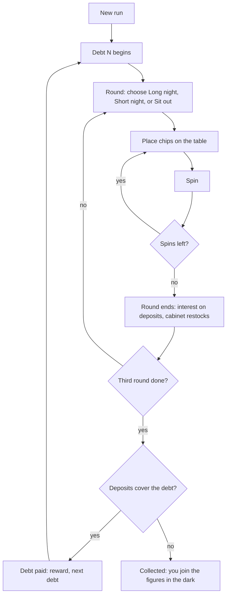

# Rien Ne Va Plus: Game Design Plan

*Rien ne va plus* is the croupier's call when betting closes: "no more bets".
Decisions made so far are listed under [Decisions](#12-decisions).

Status: Phase 1 (the core loop), Phase 2 (talismans, the Curio Cabinet,
tokens and the Bell), Phase 3 (Nudge, the Lean, pity, the Devil, cursed
talismans) and Phase 4 (Madame Zero, records, engravings) are built, and so
are touch and the phone layout (M1), the main menu and the starting chip sets
(decision 26). Phase 5 (building the wheel) is built, in two halves
(decisions 27 and 28): wheel work, pocket enhancements, the Cabinet's
oddities and the stats chalkboard; then bet levels with the payout placard,
chips and records as oddities. Phase 6 (meta) is built (decision 29): the
Vault's locks and the moving goal, stepping out of the light, the starting
wheels and House Edge levels, the figures in the dark and the Almanac.
Phase 7 (content and balance) is built (decision 30): 68 talismans, 25
cards and 12 records, the special bets on a racetrack, multi-ball, what the
locks and feats open, Endless after the Vault, and a simulator curve that
runs to debt 8. Phase 8 (polish) is built (decision 31): an Info book on
the menus, fuller Settings, first-time tips, a synthesised audio pass and the
floor painted off the main thread. The builds pass (decision 32, 6.8) added
the Pyre and the piece each build lacked, and decision 33 a legendary
multiplier for each of the four weakest builds: 83 talismans, 31 cards and
16 records. Phase 9 (store releases) comes next.
Phones are the main platform and Steam the second (9.10); see [10](#10-roadmap). Every number here is a first draft meant to be tuned with the
balance simulator described in [9.8](#98-testing-and-the-balance-simulator).

**Contents**

1. [What we take from Clover Pit](#1-what-we-take-from-clover-pit)
2. [Pillars](#2-pillars)
3. [Premise and setting](#3-premise-and-setting)
4. [The run at a glance](#4-the-run-at-a-glance)
5. [Core systems](#5-core-systems)
6. [Content drafts](#6-content-drafts)
7. [Meta progression](#7-meta-progression)
8. [Presentation](#8-presentation)
9. [Technical plan](#9-technical-plan)
10. [Roadmap](#10-roadmap)
11. [Risks](#11-risks)
12. [Decisions](#12-decisions)

---

## 1. What we take from Clover Pit

### 1.1 Why its systems work

Reading the mechanics you sent, these are the design ideas that create the
feeling, separated from their slot-machine specifics.

| Clover Pit mechanic | What it does for the player | Our equivalent |
|---|---|---|
| Symbol **weights**, +0.8 per boost | Visible probabilities you can push, with built-in diminishing returns | Pocket **widths** on the wheel (5.4) |
| **Luck** forces symbols to match; thresholds guarantee wins | Luck is concrete and countable, not a vague % | **Nudge**: the ball hops toward your bets (5.6) |
| Spontaneous luck: generous **first deadline**, then a predictable schedule, plus **pity** after misses | The house "lets you win" early; experts learn to predict and plan around it | **The Lean**, telegraphed one spin early (5.6) |
| **666**, rolled last, ignores luck, capped | A risk you cannot build away; dread | **The Devil** (5.7) |
| Value × Multiplier × Pattern value × Pattern multiplier | Every upgrade is a ratio; decisions are about which factor is weakest | Chip value × Stake × Odds × Odds mult (5.5) |
| Rarity by reroll | Rare items feel rare without empty shops | Same idea, our own weights (5.8) |
| **Phone calls**, with **evil calls** triggered by hidden conditions | A mysterious other party; tempting deals with teeth | **Madame Zero's fortunes**, white and black cards (5.9) |
| **Memory cards** | Run-wide rule changes | **Records** on a gramophone (5.10) |
| **Traits** on charms | Same item, different roll; reasons to reroll | **Engravings** (6.4) |
| Fixed early debts, then super-exponential | Runs always end; numbers get absurd | Our own debt table (5.2) |
| Restock cost grows per buy, **resets each deadline** | Spending pressure renewed every deadline | Same shape, our numbers (5.8) |
| **Skip rounds** for tickets | Trade tempo for build | **Sit out** a round (5.2) |
| **Drawers** set the goal deadline | Each run pushes the finish line further | **Vault locks** (7.1) |

### 1.2 What the screenshots say about the feeling

- **One small place, everything within reach.** The cell holds the machine, the
  ATM, the store, the phone, the drawers. You turn your head between stations;
  you never walk anywhere.
- **The objects are the interface.** Prices sit on glass cases, the debt lives on
  the ATM, the 666 chance is written on a floppy disk, the lever is a lever.
  The only flat HUD is a few chunky counters in the corners.
- **Grime and one harsh light.** Mossy concrete, a caged bulb, prison bars,
  coins on the floor. Low-resolution textures and a crunchy, PS1-like render.
- **Mystery in the margins.** "DON'T TRUST..." scrawled on the wall, a red phone,
  a rarity chart nailed up like a notice.
- **Short, loud spins.** Big popups ("+376"), highlighted winning symbols, the
  "SPINS LEFT" counter ticking down.

### 1.3 What we deliberately leave behind

We keep the feeling and the structure, not the content: no slot symbols, no
phone, no ATM, no "Lucky Charms", no clover tickets, no drawers and box, and none
of Clover Pit's formulas or tables copied over. Roulette gives us mechanics
slots do not have, and the plan leans on them:

- **Two geometries.** Numbers sit next to different neighbours on the *wheel*
  (0-32-15-19...) and on the *table* (1-2-3 rows, 1-4-7 columns). Builds can
  play either map.
- **Every bet has the same base expected value.** A straight-up and a bet on red
  return the same on average and differ only in variance. Items break that
  symmetry, which makes every build a readable choice.
- **The ball travels.** It orbits, drops, bounces through pockets and settles.
  That path is where luck becomes visible.
- **Real casino vocabulary.** Voisins du Zéro, Tiers du Cylindre, Orphelins, the
  Snake bet, Finales, *rien ne va plus*. Free flavour that also works as content.
- **The numbers on a roulette wheel add up to 666** (0 + 1 + ... + 36). Our
  devil is already built into the wheel.

---

## 2. Pillars

1. **The light is the cell.** You never leave the pool of light around the giant
   wheel. Beyond it is darkness, and things stand in it.
2. **Everything is an object.** Debt, prices, odds and luck are shown on things
   in the room. The flat HUD is a handful of counters.
3. **Fast spins, loud payouts.** A spin takes 4–6 seconds, or about 2 in fast
   mode. Every win is a small show.
4. **Luck you can see and count.** Nudge, Leans and the Devil are announced and
   numeric. Players should be able to plan around them, and the best ones should
   be able to predict them.
5. **Build the wheel, not just the bets.** Your items, your chips *and the wheel
   itself* change over a run. A late-run wheel should look different from the
   one you started with.

---

## 3. Premise and setting

You wake standing at a small baize table at the rim of an enormous roulette
wheel, in a dark hall with a plank floor. A single bulb hangs over the wheel.
A brass teller's cage tells you what you owe and how many nights you have.
Somewhere in the dark, an automaton fortune teller, **Madame Zero**, runs the
House. She speaks through a horn: *"Faites vos jeux."*

Around the edge of the light stand still figures, facing the wheel. Each is
someone who could not pay. On your first run there is one. Every run you lose
adds another, and that one is you (7.3).

Colour carries meaning: **green belongs to the House.** The zero pocket, Madame
Zero's glowing eyes, cursed items and the Devil's chance indicator are the only
green things in the room. Everything else is mahogany, brass, ivory, oxblood
felt and the red and black of the numbers.

Light lore, delivered through scrawls on the floorboards and the backs of
fortune cards: "IT ALL ADDS UP TO 666", "ZERO IS NOT EMPTY", "DON'T TRUST THE
LEAN", "SHE WAS A PLAYER ONCE". The full story is left open for later; the
Vault ending (7.1) is where it pays off.

---

## 4. The run at a glance



- A **run** is a sequence of **debts**.
- Each debt has **3 rounds** ("nights").
- Each round you buy a number of **spins**, or sit the round out.
- Between spins, at any time: rearrange chips, buy and sell at the Curio Cabinet,
  deposit coins at the Cage, visit Madame Zero (once per debt), ring the Bell.
- At the end of the third round the Cage collects. Short of the debt, the run ends.

---

## 5. Core systems

### 5.1 Money

| Currency | Earned from | Spent on |
|---|---|---|
| **Coins** | Winning chips, some items, debt rewards | Spins, Cabinet restocks, fortune rerolls, deposits |
| **Tokens** (brass casino tokens) | Every night's end, short nights, sat-out rounds, debt rewards, some items | Talismans and oddities at the Curio Cabinet |

**The Cage.** Deposits are one-way: coins go in and count toward the debt. At the
end of every round, deposits earn **interest (base 5%)**. Coins in hand are what
you spend, and what the Devil takes (5.7). The core money decision is to bank
coins (safe, growing) or keep them in hand (restocks, rerolls, flexibility).
The Cage also pays **+1 token** at the end of every night, with the interest.

When a debt is paid, the debt amount is removed from the deposits and any surplus
stays in the Cage, still earning interest.

**Starting state:** 10 coins, 4 tokens, 3 clay chips of value 1, the European
wheel, 6 talisman hooks.

### 5.2 Debts, rounds and spins

At the start of each round, choose one:

| Choice | Spins | Cost | Bonus |
|---|---|---|---|
| **Long night** | 7 | 7 × spin cost | none |
| **Short night** | 3 | 3 × spin cost | +1 token now |
| **Sit out** | 0 | none | +3 tokens when the debt is paid |

Debt table (first draft, debts 2 and 4 tuned in Phases 3 and 4, debts 2 and
5–9 in Phase 7). Spin cost follows Fibonacci, a small detail players can
spot. Phase 3 set debt 2 to 333 (half of 666) and debt 4 to 1,332 (twice
666). Madame Zero's lasting cards then carried too many runs through, so
Phase 4 raised them to 400 and 2,664 (four times 666). Debt 3 stays 666
(decision 14). Phase 7's larger pool thinned a new player's Cabinet, and
debt 2 came down to 370; the debts past the first goal came down to the
gentle tail (decision 30), with debt 9 eased so endless runs climb smoothly
into the doubling growth.

| Debt | Owed | Spin cost | Restock base |
|---|---|---|---|
| 1 | 60 | 1 | 2 |
| 2 | **370** | 2 | 5 |
| 3 | **666** | 3 | 15 |
| 4 | **2,664** | 5 | 50 |
| 5 | **8,000** (drafted 12,000) | 8 | 200 |
| 6 | **18,000** (drafted 36,000) | 13 | 700 |
| 7 | **40,000** (drafted 120,000) | 21 | 2,000 |
| 8 | **95,000** (drafted 370,000) | 34 | 6,000 |
| 9 | **250,000** (drafted 1,300,000) | 55 | 8,000 |
| 10+ | previous × 6 × 2^(N−10) | Fibonacci continues | owed ÷ 50 |

From debt 10 the growth factor itself doubles each debt (×6, ×12, ×24...), so
endless runs reach absurd numbers. That is why money uses a big-number type from
day one (9.5).

**Debt reward:** +2 tokens, +3 tokens per sat-out round, and coins equal to 3 spins
at the next debt's spin cost.

**Token income** in a debt is then 3 (one per night) + 2 (the reward), plus 1 per
short night and 3 per night sat out: about 5–8 tokens a debt, or two commons. The
doc's first draft (short nights, sit-outs and +1 per debt only) gave about 2 a
debt, too little for a shop to matter, so the owner chose a token every night.

**First sanity check (debt 1):** three chips of value 1 return about
3 × 36/37 ≈ 2.9 coins per spin, against a spin cost of 1. Three long nights are
21 spins, about +40 net, plus Leans and interest. With 10 starting coins that
lands near 60 when nothing goes wrong, so a first talisman or a good Lean decides
it. That is the intended tension.

**Phase 1 simulator result** (no items, Leans or Devil): about 31% of runs pay
debt 1, about 1% pay debt 2, none reach debt 3. Debt 2 charges 2 per spin
against about 2.9 coins of income, so only multipliers can carry a run.

**Phase 2 simulator result** (talismans, no Leans or Devil; 2,000 runs per bot).
The best bot, which adapts its bets to what it owns, pays debt 1 in about 82% of
runs, debt 2 in about 44%, debt 3 in about 4%, and never debt 4; an outside bettor
pays debt 1 most often (86%) but fades at debt 2 (29%). Debt 1 and 2 sit a little
under their Phase 2 targets (9.8). Debt 3 (666 owed) is a wall without Leans and
Nudge: the spec predicted it, and Phase 3 is where it gets tuned. The debt table
stays as drafted until then. Strongest alone: the Glass Eye (a sure straight-up
once a debt). Weakest early: Horseshoe and Wheel of Fortune.

**Phase 3 simulator result** (Leans, pity, Nudge, the Devil and eight new
talismans; 2,000 runs per bot). Luck turned out far stronger than the first
draft assumed. One point of Nudge lets every straight-up reach two more pockets,
so a straight-up's expected return grows with 2N + 1, and spreading straight-ups
around the wheel (the skill 5.6 describes) turns a +5 Lean into a near-certain
36× hit. With the drafted numbers, a bot with no talismans that simply played
the Leans paid debt 2 almost every time, and pity (which a straight-up player
earns on most spins) was worth a Lean every few spins. The numbers in 5.6 and
6.1 were cut to fit, and debts 2 and 4 moved to half and twice 666 (the owner
allowed the debt table to change if luck alone could not shape the curve, with
debt 3 fixed at 666). The best bot, which plays every Lean with straight-ups
spread around the wheel when that pays more, now pays debt 1 in about 99% of
runs, debt 2 in 70%, debt 3 in 29% and debt 4 in 10%, all inside the Phase 3
targets (9.8). The Devil fires at least once in about 17% of its runs; a bot
that banks after every spin loses little to it. With the 43 talismans (6.1) the
best bot at each debt pays debt 1 in about 99% of runs, debt 2 in 74% (a
straight-up luck builder), debt 3 in 25% and debt 4 in 8% (the adaptive bot):
inside the targets, near the debt 2 ceiling and the debt 3 floor.

### 5.3 The table: chips and bets

Chips are **owned objects, not wagers.** You do not risk them. A chip placed on a
bet pays when the bet wins and does nothing when it loses. The coin cost of a spin
is the risk, as with Clover Pit's spin cost.

- Start with 3 chips. Gain more from the Cabinet, fortunes and items.
- Chips stay where you left them between spins ("let it ride"). Rearranging is free.
- Several chips can stack on one bet; each pays separately.

**Odds** are the total return per unit of chip value, i.e. 36 ÷ numbers covered
(rounded down for sector bets, which keeps a slight house edge).

| Bet | Covers | Base odds | Notes |
|---|---|---|---|
| Straight up | 1 | 36 | |
| Split | 2 | 18 | adjacent on the table |
| Street | 3 | 12 | a row |
| Corner | 4 | 9 | |
| First Four | 4 | 9 | 0-1-2-3 |
| Six Line | 6 | 6 | two rows |
| Dozen | 12 | 3 | |
| Column | 12 | 3 | |
| Red / Black | 18 | 2 | by current pocket colour |
| Odd / Even | 18 | 2 | |
| High / Low | 18 | 2 | |
| *Neighbours* | 5 | 7 | number ± 2 on the wheel (unlockable) |
| *Finale* | 3–4 | 9–12 | numbers ending in a digit (unlockable) |
| *Jeu Zéro* | 7 | 5 | 12-35-3-26-0-32-15 (unlockable) |
| *Orphelins* | 8 | 4 | 1-20-14-31-9 and 17-34-6 (unlockable) |
| *Tiers du Cylindre* | 12 | 3 | the arc opposite zero (unlockable) |
| *Snake* | 12 | 3 | 1-5-9-12-14-16-19-23-27-30-32-34 (unlockable) |
| *Voisins du Zéro* | 17 | 2 | the arc around zero (unlockable) |

**Zero** loses every bet except bets that include it. It is the natural, frequent
"house wins" moment, and items can turn it around (House Key; later Saint's Medal).

**Bet levels.** Some fortunes and oddities level up a bet type. Each level adds the
base odds again (Straight up: 36 → 72 → 108). This is the slow, permanent scaling
axis, the counterpart of upgrading pattern values.

*As built (Phase 5, decision 28):* each of the 14 kinds of bet has its own
level for the run. At the owner's word after the simulator, each level adds
**a quarter** of the base odds, not the whole (straight-up 36 → 45 → 54, red
2 → 2.5 → 3). Every bet of the kind pays at its level's odds, before Stake,
the Odds mult and the rest (5.5), and the House rounds down as ever. Levels
come from the Brass Odds Plate (6.7; tap a bet on the felt to raise its kind)
and from two of Madame Zero's cards (6.2). The payout placard shows them
(5.11), and a raised bet's note starts from its level.

*As built (Phase 7, decision 30):* the seven special bets lie on a
**racetrack** printed across the top of the felt, above the numbers (8.1):
Neighbours, Finales, Voisins, Tiers, Orphelins, Jeu Zéro and the Snake, each
a zone with its odds. They are **closed** until something in the run opens
them; a closed zone sinks into the dark under a brass crosshatch and takes
no chip. The Croupier's Glove opens Voisins, Tiers, Orphelins, Jeu Zéro and
the Finales; Snakeskin the Snake; Madame Zero's "Neighbours talk." the
Neighbours; and the Habanera all seven while it plays. A chip on the
Neighbours or Finales zone asks which number (a grid laid out as the felt,
the zero down its left) or which last digit. Neighbours follows the run's
own wheel (the American and the Mirror have their own order); the sectors
keep their European numbers. The odds are the table's; a Finale pays 9, or
12 on 7, 8 and 9, which have three numbers. Levels apply to them as to any
kind, and the placard and levels list only the kinds that are open.

### 5.4 The wheel: pockets you can build

The wheel is the deck. Each pocket has:

- a **number** (0–36),
- a **colour** (red, black, green),
- a **width** (base 1.0). The chance of landing in a pocket is its width over the
  total width. **The wheel is drawn from the widths**, so a widened pocket is
  physically wider on screen. Probability is something you can see.
- an optional **enhancement** (6.5).

Wheel-building actions, from items, fortunes and oddities:

| Action | Effect |
|---|---|
| Widen | +0.5 width. Diminishing returns come for free, because each widen is a smaller share of a bigger total. |
| Narrow | −0.5 width (minimum 0.25) |
| Repaint | Change a pocket's colour. Red/Black bets follow the paint, and the felt layout recolours to match. |
| Duplicate | Insert a second pocket with the same number. The table shows "×2" on that number. |
| Remove | Delete a pocket (minimum 18 pockets) |
| Enhance | Gild, glass, bone... (6.5) |

Bets follow **number labels**: a straight-up on 17 covers every pocket labelled 17.

*As built (Phase 5, first half; decision 27):* each pocket is
`{ id, number, color, width, enh }` (`core/wheel.js`). The id stays with a
pocket while others come and go, so a Glass Eye's foreseen landing stays on
its pocket. Wheel work lives in `core/wheelwork.js`; every piece names what
it acts on:
- **Gild**: gilded, or platinum if already gilded.
- **Enhance**: puts an enhancement on the pocket, replacing what it had.
- **Widen** and **Narrow**: ±0.5 on every pocket with a number (the felt
  picks a number, and duplicates share it).
- **Paint**: red or black.
- **Duplicate**: a plain copy, width 1, cast right after the pocket
  (clockwise).
- **Remove**: never below 18 pockets, and never the pocket the Glass Eye
  foresaw.
- **Stamp**: a new number. The pocket keeps its paint; a blank one takes
  the number's colour.

The wheel holds 60 pockets at most. Talismans still lean on the widths while
they hang (Brass Scales) through pure `widths` hooks (`core/widths.js`). The
view draws every pocket at its live width: a new pocket grows in from
nothing, a chiselled one shrinks away, and each pocket's paint and
enhancement show on its number cell and its floor (8.1). Wheel work comes
from three places:
- the Cabinet's oddities (5.11, 6.7);
- three of Madame Zero's cards (6.2);
- the **Number Punches** (legendary, a Bell active once a debt): up to 3
  pockets re-stamped with any numbers. It answers only a ring at its tag,
  because you choose what it stamps.

A stats board in the room (5.11) shows the live chance of every number, colour,
dozen and column, so a heavily built wheel stays readable.

### 5.5 Spin resolution

The outcome is decided **before** anything moves. The animation is then
choreographed to deliver that result (9.6). This keeps results deterministic,
testable and replayable, and it is the only way luck can be shown honestly.

Order of operations:

1. **Before the spin:** Bell actives are rung before this point, while betting
   (5.8). Run before-spin hooks; total up Nudge (talismans + Lean + pity); total
   up the Devil's chance.
2. **Land:** draw a pocket for each ball by width (RNG stream `wheel`). A landing
   the Glass Eye foresaw is used instead of a draw.
3. **Nudge:** each ball may hop up to *N* pockets along the wheel toward the best
   payout (5.6).
4. **Devil:** roll the Devil's chance (stream `devil`). Nudge cannot help here. If
   it fires, skip to 5.7.
5. **Pay:** for each ball, for each chip whose bet covers the landed number, and
   for geometry effects such as Mirror Shard and Croupier's Rake, compute the
   payout. Talismans trigger left to right along the rail: for each chip, each
   talisman in rail order adds its Stake, then its odds, then its multipliers,
   so the playback is strictly left to right.
6. **Wheel of Fortune:** if it was armed and the spin pays nothing, the ball is
   thrown again (fresh draws, steps 2–5 again) and the second result stands.
7. **After the spin:** update streaks (repeats, hot dozens) and run after-spin
   hooks.
8. **Bank** the total into coins in hand.

**Payout of one winning chip:**

```
payout = chip value × Stake × odds × Odds mult × pocket mult × (each × talisman)
```

- **Stake** starts at 1. Bonuses add to it ("+1 Stake").
- **Odds** is the bet's base odds × its level.
- **Odds mult** starts at 1. Bonuses add to it ("+1 Odds").
- **Pocket mult** is the enhancement of the pocket that pays (gilded ×2,
  platinum ×3, glass ×4; a pocket has one enhancement, 6.5). It acts after
  the chip's material and before the rail. A blank pocket pays nothing,
  whatever covers it.
- **× talismans** multiply one after another.
- A secondary hit (Croupier's Rake's neighbours) multiplies by its own factor
  (×¼). Each chip's payout is rounded down once, at the end.

Two brass plaques on either side of the felt show **STAKE ×n** and **ODDS ×n**.
As in Clover Pit, the useful question is always which factor is weakest
relative to what an upgrade adds.

A **miss** is a spin where no chip pays. Coins from talismans (Lucky Penny) do
not undo a miss. Misses feed pity (5.6).

**Multi-ball** (*built in Phase 7*). A spin can throw more than one ball.
Talismans, a card and a record add balls (`balls` hooks, shown before the
spin, so the player bets knowing). Each ball draws its own pocket, Nudge
and the Lean act on every ball, and every chip is paid for every ball that
lands on its bet; an extra ball's lines pay at that ball's own factor
(the Ivory Ball's ×½), which multiplies like a secondary hit. The Devil
reads the throw as one: if he fires, the whole spin is his. The view throws
the extra balls with the first, in ivory, and they settle in their own
pockets (8.1).

### 5.6 Luck: Nudge and the Lean

**Nudge** is luck as a number of pocket hops. After the ball settles, it may creep
up to *N* pockets clockwise or anticlockwise along the wheel, to whichever
reachable pocket pays the most. Ties go to fewer hops, then clockwise. If it is
already on the best reachable pocket, it stays. Every hop shows a spark and a tick.

- With 18 Nudge on a 37-pocket wheel, every pocket is in reach, which guarantees
  the best possible result. This is our "jackpot threshold".
- This creates roulette's own placement skill: **spread straight-ups around the
  wheel**, not the table, so any Nudge has something to reach.
- Some items restrict direction or target (Compass, Lodestone) to create builds.
  A restriction applies to all of the spin's Nudge, the Lean's and pity's too.
- "Pays the most" counts every coin the landing would bring: chip payouts plus
  coins from talismans (Lucky Penny, the Beckoning Cat). The search is pure: it
  scores each pocket with the same payout plan the spin uses (`core/nudge.js`).
- An anchor (the Thirteen Ball on 13) holds the ball where it lands. It shows
  itself only on a spin where it kept the ball from hopping somewhere better.
- A Black Cat crossing cancels all of a spin's Nudge, the Lean's and pity's
  included; the board and the Lean's creak say so before you bet.
- **Nudge is worth a lot.** Each point lets every straight-up reach two more
  pockets, so with chips spread around the wheel a straight-up's expected return
  grows with 2N + 1, and +1 Nudge on every spin already makes a red or black bet
  pay every time (red and black alternate round the wheel; Odd and 1–18 can still
  miss on zero, whose neighbours are both even and high). The numbers below are
  tuned to that (5.2, Phase 3 simulator result).
- A clockwise-only Nudge (Compass) can reach the whole wheel less one pocket;
  a Nudge that hops both ways needs only half the wheel to reach every pocket.

**The Lean** is spontaneous Nudge from the House.

- **Telegraphed one spin early.** The bulb hums brighter, the wheel creaks and a
  LEAN lamp lights on the results board *before* you bet. You can move chips onto
  riskier bets for that spin. Clover Pit's sparks arrive mid-spin; ours give you a
  betting decision.
- **Debt 1 (teaching):** Leans on spins 2, 5, 9, 14 and 20 of the debt, each +2
  Nudge (drafted +5), with the whole schedule shifted by 0 or 1 at random. The
  count runs across the debt's nights, so a Lean can be announced at the end of
  one night for the first spin of the next. It never crosses the end of the
  debt: once the last night is over, a Lean scheduled after its last spin is
  dropped and never shown.
- **From debt 2:** each long night has one Lean on a random spin after the first;
  a short night gets one on a coin flip. Strength +3 to +5, and +3 more if it
  falls on the night's last spin. **From debt 5** the House grows stingy and Leans
  come only every other night of the run (debt 5: nights 1 and 3; debt 6: night
  2; and so on). Because each Lean is announced a spin ahead, players learn to
  hold Bell charges and risky chips for it.
- **Pity:** after 5 misses in a row, +1 Nudge, then +1 more for each further miss
  until something pays (drafted: after 3, +4 then +2). A straight-up player
  misses most spins, so the drafted pity worked like a free Lean every few spins.
  Pity shows a different, colder spark, so players do not confuse it with a
  Lean. The count runs across nights and debts, and a Devil's spin counts as a
  miss.
- **Where it shows:** the results board carries the LEAN lamp with the Lean's
  strength, the next spin's total Nudge and pity (5.11). The wheel's bulb hums
  brighter in the dark and the wheel creaks when a Lean is announced.
- The Lean's spin and strength are rolled from the `lean` stream: debt 1's
  schedule when the debt begins, a later night's Lean when the night is chosen.
  Nothing about a Lean changes where the ball is drawn.

### 5.7 The Devil

The wheel's numbers sum to 666. After the second debt is paid, the House notices
you: a green "666" counter appears on the Cage and the Devil is live.

- **Chance:** 1.5% at debt 3, +0.5% per later debt, plus cursed engravings and
  pockets, minus items (Salt Cellar, Evil Eye). **Cap 25%.** The current chance is
  always shown on the counter (to the thousandth of a percent, so two halvings
  read 0.375%). Talismans adjust it in rail order, so a Salt Cellar right of an
  Evil Eye is worth more than one to its left (1.5 ÷ 2 − 0.5 = 0.25%, against
  (1.5 − 0.5) ÷ 2 = 0.5%). Before the Devil is live nothing changes it.
- **Rolled after Nudge, and Nudge cannot touch it.** It is rolled once per throw
  from the `devil` stream (twice on a Wheel of Fortune re-throw), and only while
  the chance is above zero.
- **When it fires:** the spin pays nothing (no talisman's payout hook runs, so
  no Lucky Penny refunds), an armed Wheel of Fortune is spent without a re-throw,
  the landing is not counted for the Ledger and the Abacus, and the board shows
  666 in green. After-spin hooks still run (the Piggy Bank still grows). The
  number under the ball burns away to "666", the bulb goes
  out, and **every coin in hand is lost**. Deposits are safe, which is why
  banking matters.
- **Wards:** Holy Water turns the Devil away once: the 666 flares and fails,
  the vial shatters and leaves the rail, and the spin pays as usual. A warded
  throw does not count as the Devil firing. The vial is used up once the spin is
  over, so the whole spin pays with the rail it was thrown with (a Tuning Fork
  or Twin Mirrors beside it keeps its target). On a Wheel of Fortune re-throw
  each throw needs a ward of its own: a vial that warded the first throw is
  spent for the second.
- **Aftermath:** if you have not visited Madame Zero yet this debt, she now deals
  black cards (5.9).
- Some cursed items feed on the Devil (Black Candle, Bone Dice), a niche path like
  Clover Pit's Depression charm.

The existing harmless bulb flicker stays as an omen that means nothing, so a real
blackout lands harder.

### 5.8 Talismans and the Curio Cabinet

**Talismans** are gambler's superstitions and curios: a rabbit's foot, an evil
eye, a pawn ticket. They hang on a brass **rail** above the table, on **6 hooks**
at the start. **Order matters**: they trigger left to right, which matters for
copy effects, retriggers and "first/last" effects. Drag one along the rail to
reorder it (or Tab to it and press [ or ]).

**Selling** returns half the price paid, rounded down, at least 1 token (common
1, uncommon 2, rare 3, legendary 4). Each talisman remembers what it cost. A
sold talisman can be offered again. **Cursed talismans cannot be sold**, nor
traded in for a purchase: once hung, they keep their hook for the rest of the
run (owner's decision, 12).

**The Curio Cabinet** is a low glass counter with 4 lit compartments: 3 talismans
and 1 **oddity** (a chip, a piece of wheel work, a record or a bet level).
*As built (Phase 5, decision 27):* the 4th compartment opens with wheel work
(6.7). It restocks with the others, by the same rarity reroll, and is priced
in coins, a number of the debt's spins.

| Rarity | Price (tokens) | Relative weight | Chance, first compartment (41 in the pool) |
|---|---|---|---|
| Common | 3 | 1.00 | 47.7% (16) |
| Uncommon | 4 | 0.85 | 38.0% (15) |
| Rare | 6 | 0.60 | 10.7% (6) |
| Legendary | 9 | 0.30 | 3.6% (4) |
| Cursed | from black cards only (Phase 4) | none | none |

Rarity works by reroll, as in Clover Pit: pick a random item, then reroll it with
probability 1 − weight (stream `cabinet`). Nothing on the rail is offered, and
the same talisman never fills two compartments at once. Later compartments
shift a little, since they cannot repeat the first.

**Buying** takes a free hook. With the rail full, the Cabinet asks which talisman
to sell; the sale and the purchase happen in one step, so the refund can help
pay. An **instant** talisman (the Lost Wallet) never takes a hook: it is opened
the moment it is bought, so a full rail never stops it.

**Used up.** Some talismans leave the rail on their own: Grandmother's Purse
crumbles when its interest runs out, the Four-Leaf Clover wilts after its sixth
bloom, Holy Water shatters when it turns the Devil away. A Twin Mirrors' copy
of one goes dark instead, and the mirror keeps its hook. A copy belongs to the
talisman it copies: hang a new one beside the mirror and it is copied fresh,
while moving the same one away and back finds its copy as it left it.

**Tuning Fork.** A fork triggers the talisman to its left again, straight
after it, on that talisman's own data: a Piggy Bank grows twice a spin and a
String of Pearls strings two pearls a hit. Forks pass through forks (two in a
row repeat it twice more), a fork never acts on its own, it echoes no Bell
ability, purchase or sale, and Twin Mirrors cannot copy it. It also has nothing
to repeat beside an effect that cannot happen twice (Holy Water's ward, the
Wind-Up Key's threshold, the House Key's zero, the Dowsing Rod's twitch): it
stays dark there. Beside the Beckoning Cat it pays the Cat's coins again, once a
night like the Cat.

**Restocks:** free at the start of every night, including the first. A paid
restock costs the debt's restock base, +20% (rounded up) after each paid
restock, resetting every debt (debt 1: 2, 3, 4, 5, 6, 8...). Restocking never
changes the spins: the Cabinet draws from its own stream.

**The Bell.** A brass service bell on the table wakes active talismans: the
Wheel of Fortune, the Glass Eye, the Piggy Bank and the Dowsing Rod. Ding.

- **One ring wakes one talisman:** the leftmost that can answer. Clicking a
  talisman's brass tag rings the Bell for that one.
- **The Piggy Bank** only answers a ring at its own tag, because smashing it
  cannot be undone.
- When nothing can answer, the bell rings dull and nothing changes.
- **Charges** refill at each new debt, except a charge still waiting to act (a
  foreseen landing, or an armed throw, not yet spun).
- **Wheel of Fortune** (2 charges a debt): ring it before a spin to arm it. If that
  spin pays nothing, the ball is thrown again and the second result stands. The
  charge is spent even when the first throw pays.
- **Glass Eye** (1 charge a debt): the next landing is drawn when you ring, shown
  on the felt and in the note, and the next spin lands there. Bets can be moved
  onto it.
- **Dowsing Rod** (2 charges a debt): ring it for +4 Nudge on the next spin. It
  does not answer before a Black Cat crossing (a spin with no Nudge at all), and
  a rod already twitching waits the crossing out. Like an armed Wheel of
  Fortune, a rod still twitching when the debt turns over keeps that charge
  spent.
- The Bell works whenever betting is open: before choosing a night, while
  betting, and after the night's last spin.

### 5.9 Madame Zero: fortunes

A fortune-teller automaton in a glass booth at the edge of the light. **Once per
debt**, pull her lever and she dispenses **3 fortune cards**. Take one. Rerolling
costs coins: the debt number + the number of rerolls already made.

- **White cards:** ordinary fortunes (6.2). Some have a maximum number of picks.
- **Black cards:** cursed deals with real upside and real damage (6.2). Dealt when
  the Devil fired earlier in this debt before your first visit. The deal is fixed
  the moment you first pull the lever, so you can choose to visit before or after
  the risky spins.
- Card text is written as her voice ("The reds run warm tonight"). Each card back
  carries a line of lore.

*As built (Phase 4):*
- **The lever.** The debt's first pull is free and deals 3 different cards by
  the Cabinet's rarity reroll, from the `fortunes` stream (so a visit never
  changes a spin). It fixes the deal's colour: all 3 black if the Devil fired
  this debt before that pull, all 3 white otherwise. A reroll deals 3 new cards
  of the same colour for coins: the debt's number plus the rerolls already made
  this debt (debt 2: 2, 3, 4...).
- **Taking one** ends the visit for the debt: the lever gives nothing more until
  the next debt. A deal left untaken stays on her counter until the debt ends.
  Her booth works in every phase but game over, like the Cabinet.
- **A card that could do nothing is never dealt** (no Bell talisman to recharge,
  no free hook for a cursed talisman, every record already owned), and a dealt
  card that can no longer act (the rail filled since) cannot be taken.
- **Lasting cards** (Feed the zero, Ask the figures) stay as boons that act
  before the rail, after the record, for the rest of the run.

### 5.10 Records

A gramophone holds **one record** (two once the Vault's second lock is open). A record changes
**the music and one global rule** for as long as it plays. You can swap
records freely, but only the one playing has any effect. Records are sold as
oddities, found in the Vault, and occasionally given by fortunes. This puts the
soundtrack inside the build. Drafts in 6.3.

*As built (Phase 4):* records come only from the white card "Someone left a
record." (it plays at once if nothing is playing). *Phase 5:* the Cabinet's
4th compartment also sells them (6.7), one not yet owned at a time. Swapping works in every
phase but game over and costs nothing; the record acts before every other
source, and keeps its own data between plays (Boogie-Woogie's streak). Two
rules close the gaps free swapping would open: **Overture of Excess** doubles
the debt of any debt it plays during, even if it stops before the Cage collects,
and **Static** cannot stop while a talisman hangs on the hook it adds. Each
record has its own synthesised loop (8.6); with nothing on, the hall hums.
*Phase 6:* a run begun with the Vault's second lock open has a **second
slot** on the gramophone: both records act, the first slot's first, and the
first slot's tune plays. A record given by a card or bought plays at once in
a free slot. Danse Macabre is built (6.3).

### 5.11 Chips, oddities and the room's boards

- **Chip materials** (6.6) are the per-chip enhancement axis.
- **Oddities** (the 4th compartment): new chips, wheel work (gild 2 pockets, widen
  a number, repaint a pocket), bet levels, records. *As built (Phase 5, first
  half):* wheel work only (6.7), paid in coins (decision 27). Buying one opens
  the felt close-up with the numbers its work can act on lit and the rest in
  the dark. A bar over the felt's foot names the work and what to tap, with
  Cancel. Each tap is one pick; a number whose pockets differ asks which one.
  A blank pocket, having no number, has a button of its own in the bar. When
  every pick is chosen, the work is done and paid for. The camera lifts to
  the wheel, its bulb lit as for a spin, while the pockets take the work, a
  line names what changed, and you are back where you were. Nothing is paid
  until the work is done. Cancel, Back or a turn puts it down. *Second half:*
  the compartment also sells the Brass Odds Plate (a level: tap any bet, and
  the bar packs onto one line so the whole felt stays clear), a chip of each
  material, and a record. A chip or a record is bought from its card and
  goes straight into the tray or the crate. A chip is never offered to a
  full hand (six chips, the tray's six places), nor a record when every
  record is owned.
- **Boards in the room:**
  - **Results board:** a mechanical flip board showing the last 12 numbers with
    colours, spins left and the LEAN lamp. *As built (Phase 3):* the board at the
    table's right shows the LEAN lamp (dark glass, or amber with the Lean's
    strength, and a bulb on top that hums), the next spin's total Nudge, pity in
    cold blue when it is building, and the last 8 numbers, a Devil's spin as a
    green 666. The spins left are on the HUD's tally.
  - **Stats chalkboard:** the live chance of each number, colour, dozen and column.
    *As built (Phase 5):* a slate on an easel at the table's left, across from
    the results board, lit a little from within. It chalks every number's
    chance, laid out as on the felt (bright and underlined above the fair
    chance of 1 in 37, dim below; ×2 for a number with two pockets; a dot for
    each enhanced pocket; struck out when no pocket reads it). Below that it
    gives the colours, dozens, columns and halves, and the pockets wheel work
    has changed, by what was done to them. A tap opens its card, the same
    lines in plain words; with a mouse, hovering shows its note. Every bet's
    note now says how often it wins on the wheel as built, before Nudge.
  - **Payout placard:** current odds per bet type, with levels. *As built
    (Phase 5):* an ivory card in a brass frame, standing at the felt's right
    edge. It lists the 14 kinds of bet with what each pays now; a raised kind
    is printed in gold with a tally of its level, and the frame flashes when a
    level goes up. A tap opens its card; with a mouse, hovering shows its note.

---

## 6. Content drafts

A first pool to build from. Names and numbers are drafts.

### 6.1 Talismans (83 built)

**Built in Phase 2 (15):** Red Ribbon, Horseshoe, Matchbook, Lucky Penny, Crumpled
Receipt, Pawn Ticket (common); Brass Knuckles, Croupier's Rake, Ledger, Abacus
(uncommon); Wheel of Fortune, Glass Eye, Piggy Bank (rare); Twin Mirrors, House
Key (legendary). Mirror Shard is the first alternate. Saint's Medal waits (the
Black Cat came with the variety batch below): the first 15 needed corners and
interest more than a second colour or zero item. Their data lives in
`src/core/content/talismans.js`; the rows below are the rules as built, except
the drafts that share a name with a talisman built later (Black Cat, Thirteen
Ball, Ouroboros, Golden Ball): the variety table below has those as built.

**Built in Phase 3 (8):** Pocket Watch, Salt Cellar, Lodestone (common); Rabbit's
Foot, Evil Eye (uncommon); Compass (rare); Bone Dice and Black Candle (cursed,
never offered by the Cabinet; black cards deal them from Phase 4, and until then
only the debug helper hangs them). The luck items' numbers and rarities were
tuned with the simulator, because a point of Nudge is worth far more than the
first draft assumed (5.6). The rule that came out of it: a restricted Nudge is
cheaper than a free one. Lodestone's +1 reaches only straight-ups (and confines
every hop of the spin, the House's included, so it costs an outside player their
Leans), so it is common; Rabbit's Foot's plain +1 is uncommon; Compass's +3
clockwise is rare.

| Talisman | Rarity | Effect | Plays with |
|---|---|---|---|
| Rabbit's Foot | Uncommon | +1 Nudge (drafted common) | luck |
| Lucky Penny | Common | Each losing chip refunds 1 coin | economy |
| Red Ribbon | Common | Chips on red bets +1 Stake | red |
| Black Cat | Common | Chips on black bets ×2. Every 13th spin, −3 Nudge. | black, risk |
| Horseshoe | Common | Straight-up odds +12 | inside bets |
| Pocket Watch | Common | First spin of each night +3 Nudge (drafted +4) | timing |
| Salt Cellar | Common | Devil chance −0.5% | safety |
| Pawn Ticket | Common | Interest +2% | economy |
| Crumpled Receipt | Common | +1 token at the end of each round | tokens |
| Matchbook | Common | A winning chip gains +1 value for the rest of the round | scaling |
| Chalk Stub | Common | +3 coins whenever the ball lands on an odd number | flat income |
| Wishbone | Common | The first miss each round refunds its spin cost | safety |
| Evil Eye | Uncommon | Devil chance halved | safety |
| Mirror Shard | Uncommon | The pocket directly opposite also counts as hit, at ×0.5 | wheel geometry |
| Croupier's Rake | Uncommon | Straight-ups on the two pockets beside the result also pay, at ×0.25 | wheel geometry |
| Abacus | Uncommon | Dozen and column chips +1 Odds for each earlier hit on that dozen or column this round | streaks |
| Hourglass | Uncommon | +1 spin per round | tempo |
| Saint's Medal | Uncommon | Zero counts as both red and black | zero |
| Ledger | Uncommon | A number already seen this debt pays ×2 | streaks |
| Brass Knuckles | Uncommon | Corner chips ×2 (First Four is not a corner) | inside bets |
| Thirteen Ball | Uncommon | Result 13: everything pays ×13, and Nudge never moves the ball off 13 | jackpot |
| Fortune Cookie | Uncommon | Each spin names a random number; straight-ups on it pay ×7 | variance |
| Compass | Rare | +3 Nudge, clockwise hops only (drafted uncommon, +4) | luck |
| Ivory Ball | Rare | Launch a second ball every spin | multi-ball |
| Lodestone | Common | +1 Nudge, but Nudge only moves onto straight-up chips (drafted rare, +3) | luck |
| Gold Brush | Rare | Once per round, gild the pocket the ball lands on | wheel-building |
| Snakeskin | Rare | Unlocks the Snake bet; Snake chips +2 Stake | special bets |
| Croupier's Glove | Rare | Unlocks sector bets; sector chips ×1.5 | special bets |
| Wheel of Fortune | Rare | Bell, 2 charges per debt: if the next spin pays nothing, the ball is thrown again | active |
| Glass Eye | Rare | Bell, 1 charge per debt: see where the next ball lands, before you bet | active |
| Piggy Bank | Rare | Gains 1 coin of value each spin. Ring the Bell at it: smash it for twice its value. | economy |
| Table Map | Rare | Splits and corners also pay when the ball lands next to them on the table | table geometry |
| Golden Ball | Legendary | All payouts ×3; Devil chance +3% | risk |
| Ouroboros | Legendary | Same number as the previous spin: ×36 | jackpot |
| House Key | Legendary | When zero hits, every chip on the table wins | zero |
| Metronome | Legendary | Every 4th spin of a round is a Lean | timing |
| Twin Mirrors | Legendary | Copies the talisman to its right (not Bell abilities, purchases or sales; mirrors skip mirrors) | combos |
| Loaded Wheel | Legendary | On purchase, widen all red pockets +0.5 | wheel-building |
| Bone Dice | Cursed | Winning chips +4 Stake; Devil chance +2% | Devil |
| Black Candle | Cursed | Leans are twice as strong; no pity | Devil, timing |

**Built for variety (20, owner's request, 12):** Wind-Up Key, Hamsa, Grandmother's
Purse, Lost Wallet, Four-Leaf Clover, Black Cat, Brass Scales (common);
String of Pearls, Beckoning Cat, Magpie, Domino, Holy Water, Weathervane,
Seesaw, Mousetrap, Dowsing Rod (uncommon); Tuning Fork, Thirteen Ball (rare);
Ouroboros, Golden Ball (legendary). They lean on what Phases 2 and 3 built
(Nudge, Leans, pity, the Devil, the Bell, interest, tokens) plus a few new
mechanics: a Tuning Fork echoes the talisman to its left (5.8), pocket widths
drawn live (5.4), talismans that are used up, an instant one that needs no hook,
an omen shown before the spin, and a ward against the Devil (5.7). The combos
they were built for: Brass Scales with String of Pearls (more evens, and Even
pays more with every one), a Tuning Fork beside anything that grows (Piggy
Bank, String of Pearls) or multiplies, Domino and Beckoning Cat with several
chips on one bet, Mousetrap and Wind-Up Key for straight-up hunters, Holy Water
and Golden Ball against the Devil. Tuning with the simulator cut the drafted
jackpots: a ×3 on a single number pays a whole debt in one hit, so Ouroboros
is ×2 (drafted ×36), Thirteen Ball ×2 (drafted ×13), and String of Pearls'
pearls break at dawn. Alone, from the first spin, the talismans that pay on
their own clear debt 2 in about 10–80% of runs (Hamsa 11%, Red Ribbon 19%,
Rabbit's Foot and Seesaw 73%, Ouroboros and Compass 81%), with Golden Ball near
96%; the support and combo pieces (Tuning Fork, Holy Water, Lost Wallet, Brass
Scales, the Wind-Up Key, Grandmother's Purse) do little alone. A fork or a
mirror beside Golden Ball is the intended jackpot. After review, the
straight-up luck commons were cut (Wind-Up Key, Four-Leaf Clover, Hamsa, the
Dowsing Rod, Weathervane, Lost Wallet) until the best builder paid debt 2 in at
most 75% of runs.

| Talisman | Rarity | Effect | Plays with |
|---|---|---|---|
| Wind-Up Key | Common | Pity starts after 3 misses in a row, not 5 (drafted 2) | luck, inside |
| Hamsa | Common | The night's last spin: +2 Nudge (drafted +3) | luck, timing |
| Grandmother's Purse | Common | Interest +12%, 2% less each night; crumbles at 0 | economy |
| Lost Wallet | Common | Needs no hook. When bought: coins worth a tenth of the debt (drafted a fifth) | economy |
| Four-Leaf Clover | Common | On about 1 spin in 4 (shown before you bet), +2 Nudge; wilts after 6 blooms (drafted +3) | luck |
| Black Cat | Common | Chips on Black ×2. Every 13th spin of the run: no Nudge at all | black, risk |
| Brass Scales | Common | Even pockets twice as wide (drafted uncommon, half again) | even, wheel |
| String of Pearls | Uncommon | Chips on Even odds +1, +1 more for each even number tonight | even, scaling |
| Beckoning Cat | Uncommon | Once a night, 3+ chips win on one spin: coins worth 3 nights' interest on the Cage (drafted: a night's interest on every such spin) | economy |
| Magpie | Uncommon | Winning chips +1 Stake for every 8 tokens held (drafted 5) | tokens |
| Domino | Uncommon | Each winning chip +1 Stake per chip already paid this spin | stacking |
| Holy Water | Uncommon | The first time the Devil fires, he is turned away; it shatters | safety |
| Weathervane | Uncommon | On a Lean's spin, chips pay ×2 (drafted ×3) | timing |
| Seesaw | Uncommon | 1–18 and 19–36 chips ×3 after a spin in the other half | outside |
| Mousetrap | Uncommon | Winning chips +1 Stake per miss in a row before the win, up to +2 (drafted common, no cap) | streaks |
| Dowsing Rod | Uncommon | Bell, 2 charges a debt: +4 Nudge on the next spin (first built as 3 × +5) | active, luck |
| Tuning Fork | Rare | Triggers the talisman to its left again (not Bell abilities or one-time effects) | combos |
| Thirteen Ball | Rare | 13: chips pay ×2, and Nudge never moves the ball off 13 | jackpot |
| Ouroboros | Legendary | The same number twice in a row: chips ×2 | jackpot |
| Golden Ball | Legendary | Chips pay ×3; the Devil's chance +3% | risk |

**Number Punches** (legendary, Bell, once a debt: re-stamp up to 3 pockets
with any numbers) is built with Phase 5's wheel work (5.4). It is the
44th talisman.

The draft rows in the first table that share a name with a talisman here
(Black Cat, Thirteen Ball, Ouroboros, Golden Ball) are superseded by this table.

**Build families this pool supports:** colour stacking, straight-up hunting with
Nudge, wheel-geometry neighbours, table-geometry inside bets, streaks and repeats,
zero worship, multi-ball, economy and interest, Devil risk. Every family needs
at least one item at each rarity before content lock (Phase 7).

**Built in Phase 7 (24, decision 30).** The drafts not yet built, and what
each family lacked at some rarity. Thirteen wait behind the Vault's first
lock or a feat (7.1), so a new player's Cabinet offers 53 (the other 55
less the two cursed, which only black cards deal). Six were strengthened after the simulator showed them adding
nothing alone (9.8): Chalk Stub (drafted coins worth a spin), Wishbone
(drafted once a night), Hourglass (drafted +1 spin), Saint's Medal (drafted
the zero rule only), Tally Stick (drafted +1 Stake) and Marble (drafted the
last spin only).

| Talisman | Rarity | Effect | Opens with |
|---|---|---|---|
| Chalk Stub | Common | A ball on an odd number: coins worth 2 spins | |
| Wishbone | Common | The first 3 spins each night that pay nothing give their cost back | |
| Tally Stick | Common | A chip on a bet that won last spin +2 Stake | |
| Green Thread | Common | Chips on a bet that covers zero +2 Stake | |
| Marble | Common | The first and last spins of each night throw a second ball | |
| Mirror Shard | Uncommon | The pocket straight across the wheel also counts as hit, at ×½ | |
| Hourglass | Uncommon | +2 spins on every night you play | |
| Saint's Medal | Uncommon | Red and Black chips +1 Stake; a green zero counts as both | |
| Fortune Cookie | Uncommon | Each spin names a number before you bet: straight-ups on it ×3 | |
| Juggler's Ball | Uncommon | Every third spin of a night throws a second ball | |
| Ivory Ball | Rare | A second ball every spin, paying ×½ | |
| Gold Brush | Rare | Once a night, gild the pocket the ball lands in (gilded turns platinum) | feat: Platinum |
| Snakeskin | Rare | Opens the Snake; Snake chips +2 Stake | lock 1 |
| Croupier's Glove | Rare | Opens Voisins, Tiers, Orphelins, Jeu Zéro and the Finales; their chips ×1.5 | lock 1 |
| Table Map | Rare | Splits and corners touching the number on the table win at ×½ | feat: A Wheel of Your Own |
| Rose Brooch | Rare | Red or Black chips ×2 when their colour came up last spin | feat: A Thousand in a Breath |
| Hot Coals | Rare | Each paying spin in a row: chips +×½, up to ×4; a miss puts them out | feat: Same Again |
| Zero's Coin | Rare | A ball on a green zero: +3 tokens and coins worth 3 spins | feat: Ride the Lean |
| Brimstone | Rare | Once the Devil has fired this debt, chips ×2; the Devil's chance +1% | feat: Paid in Spite |
| Metronome | Legendary | Every 4th spin of a night +2 Nudge | feat: Step Out of the Light |
| Loaded Wheel | Legendary | When bought, every red pocket +0.5 wide, for good | feat: Out of the Red |
| Surveyor's Chain | Legendary | Split, street, corner and six-line chips ×3 | feat: Bare Hands |
| Bag of Marbles | Legendary | Two more balls every spin, each paying ×½ | feat: The Vault |
| Moneylender's Seal | Legendary | Interest doubled (the talismans to its left included) | feat: A Full Rail |

**Built in the builds pass (11, decision 32).** The Pyre, a new build, and
the talismans the other builds lacked (6.8). The Racing Form waits for the
Vault's first lock with the other sector openers, so a new player's Cabinet
now offers 63.

| Talisman | Rarity | Effect | Build | Opens with |
|---|---|---|---|---|
| Kindling | Common | When sold: +2 tokens | The Pyre | |
| Hand Bell | Common | Each debt, the leftmost Bell talisman gets +1 charge | The Bell | |
| Funeral Urn | Uncommon | +1 Stake for every talisman sold this run, up to +4 | The Pyre | |
| Pair of Dice | Uncommon | Two balls on the same colour: chips ×2 | Multi-ball | |
| Savings Book | Uncommon | +1% interest for every debt paid, up to +5% | Interest | |
| Raven Feather | Uncommon | Black chips +1 Stake | Colour (black) | |
| Racing Form | Uncommon | Opens the Neighbours | Sectors | lock 1 |
| Phoenix Feather | Rare | The first talisman used up each debt comes back, as new | The Pyre | |
| Pocket Calendar | Rare | Marks one spin each night, drawn from the seed: chips ×3 on it | Timing | |
| The Pyre | Legendary | Chips +×0.5 for every talisman sold or used up this run | The Pyre | |
| Gold Tooth | Legendary | Chips ×(1 + tokens ÷ 20) | Coins and tokens | |

"Used up" is one path in the core (`useUp`): a Bell talisman smashed, a
purse emptied, a clover wilted, a Holy Water shattered. Each counts for the
Pyre, and the Phoenix Feather catches the first of each debt and hangs it
back fresh (its charges and counters reset). Selling counts too, a trade-in
at the Cabinet included. The Pocket Calendar's spin is shown on its note,
so a player can load chips onto it.

**Built for the weak builds (4, decision 33).** The simulator's build bots
(9.8) showed the Bell, Sectors, Zero and Timing with little multiplier of
their own; each gets one legendary, and each opens with one of the Vault's
locks, so a first run's Cabinet stays as tuned.

| Talisman | Rarity | Effect | Build | Opens with |
|---|---|---|---|---|
| The Tote Board | Legendary | Racetrack chips pay ×1 for each different racetrack bet with chips on it (Voisins, Tiers and Orphelins together: ×3 each) | Sectors | lock 1 |
| The Carillon | Legendary | Chips +×1 for every Bell ring a talisman answered this debt | The Bell | lock 2 |
| Patience Jar | Legendary | Fills +×0.5 for every spin since a ball last landed on a green zero; when one lands, chips pay that much and the jar empties | Zero | lock 3 |
| Grandfather Clock | Legendary | Chips +×0.5 for every spin already played tonight (the first ×1, the seventh ×4) | Timing | lock 4 |

The Carillon counts rings in `state.debtRings`, which a new debt clears; a
ring nothing answers does not count. The Patience Jar is emptied by any
green zero, even one the Devil burned. The Grandfather Clock counts its
own spins each night, so a copy (Twin Mirrors) counts its own as well.

**Every family at every rarity** (a talisman counts for each family its tags
name; `tests/core/phase7.test.js` checks it):

| Family | Common | Uncommon | Rare | Legendary |
|---|---|---|---|---|
| Colour | Red Ribbon, Matchbook, Black Cat | Ledger, Domino, Saint's Medal, Raven Feather, Pair of Dice | Rose Brooch | Loaded Wheel |
| Straight-up hunting (Nudge) | Pocket Watch, Lodestone, Wind-Up Key, Hamsa, Four-Leaf Clover | Rabbit's Foot, Dowsing Rod, Weathervane, Fortune Cookie | Compass | Metronome |
| Wheel geometry and sectors | Brass Scales | Croupier's Rake, Mirror Shard, Racing Form | Compass, Gold Brush, Snakeskin, Croupier's Glove | Number Punches, Loaded Wheel, The Tote Board |
| Table geometry (inside bets) | Horseshoe, Lucky Penny, Lodestone, Wind-Up Key | Brass Knuckles, Croupier's Rake, Ledger, Mousetrap, Fortune Cookie | Wheel of Fortune, Thirteen Ball, Table Map | House Key, Ouroboros, Surveyor's Chain |
| Streaks and repeats | Tally Stick | Ledger, Abacus, Mousetrap | Rose Brooch, Hot Coals | Ouroboros |
| Zero | Green Thread | Saint's Medal | Zero's Coin | House Key, Patience Jar |
| Multi-ball | Marble | Juggler's Ball, Pair of Dice | Ivory Ball | Bag of Marbles |
| Economy and interest | Lucky Penny, Pawn Ticket, Grandmother's Purse, Lost Wallet, Chalk Stub, Wishbone, Kindling | Beckoning Cat, Hourglass, Savings Book | Piggy Bank | Moneylender's Seal, Gold Tooth |
| Devil and risk | Salt Cellar, Wishbone | Evil Eye, Holy Water | Brimstone | Golden Ball |
| Sacrifice (the Pyre) | Kindling | Funeral Urn | Phoenix Feather | The Pyre |
| Timing | Pocket Watch, Hamsa, Marble | Weathervane, Juggler's Ball, Hourglass | Pocket Calendar | Metronome, Grandfather Clock |
| The Bell | Hand Bell | Dowsing Rod | Glass Eye, Wheel of Fortune, Piggy Bank | Number Punches, The Carillon |

### 6.2 Fortunes

*As built (Phase 4, decision 22):* the cards below work as written, with these
exceptions. Waiting for its phase: "Neighbours talk" (special bets). *Phase 5:* "Gold finds gold" is built (3 pockets gilded at
random from the fortunes stream; a gilded one turns platinum). "Feed the
zero" casts a real second zero pocket beside the first (a save from before
keeps its wide zero). A black card was added so cursed pockets have a source:
**"Borrowed gold."** (uncommon), which gilds 4 pockets at random and curses 2
plain others. *Phase 5, second half (decision 28):* "Outside bets are safe
bets" and "Fortune favours the bold" are built, each legendary and once a run
(drafted uncommon, any number of times). A level lasts the run and raises
the very bets a build leans on, and bots reroll her lever until they find
one. The two chip cards, "Your stack grows heavy" and "A new chip in your
pocket", are **left out** at the owner's word. A run starts with three chips
of value 1, so either is a third more stake for the rest of the run: even
legendary and once a run, the two together lifted the best bot's debt 3 from
50% to 58%. Chips come from the Cabinet instead (6.7). "Ask
the figures" gives its +1 Nudge; the figure leaving comes with the figures
(Phase 6). Two black cards were added for decision 11, the cursed talismans'
only source: **"Roll the bones."** (the Bone Dice hang on your rail, uncommon)
and **"A candle for the dark."** (the Black Candle, uncommon). One white card
was added: **"Someone left a record."** (a record for the gramophone,
legendary, once a run: records come "occasionally" from fortunes, 5.10).
Pocket widenings are wheel work: they last the run. "Something carved in
brass" never gives the Cursed engraving. Lore lines are in
`src/core/content/fortunes.js`.

Tuned with the simulator (9.8): a card a debt adds up, since most of them last
the run. A stranger tips 2 tokens (drafted 5), the Cabinet owes 1 token
(drafted 2), and the reds and blacks widen by 0.15 (drafted 0.25). The tables
below give the tuned numbers.

**White cards**

| Card | Effect | Rarity | Max picks |
|---|---|---|---|
| "A stranger tips well." | +2 tokens | Common | none |
| ~~"Your stack grows heavy."~~ | All chips +1 value (left out, decision 28) | Common | none |
| "The bell rings twice." | Recharge all Bell talismans | Common | none |
| "The cabinet owes you." | Talismans cost 1 token less until the next restock | Common | none |
| "The reds run warm tonight." | Widen every red pocket +0.15 | Common | none |
| "The blacks run cold and deep." | Widen every black pocket +0.15 | Common | none |
| "Outside bets are safe bets." | Dozen, column and even-money bets +1 level (built in Phase 5) | Legendary (drafted uncommon) | 1 |
| "Fortune favours the bold." | Straight-up +1 level (built in Phase 5) | Legendary (drafted uncommon) | 1 |
| "Another hook on the wall." | +1 talisman hook | Uncommon | 1 |
| ~~"A new chip in your pocket."~~ | Gain a chip of a random material (left out, decision 28) | Uncommon | none |
| "Gold finds gold." | Gild 3 random pockets (built in Phase 5) | Rare | none |
| "Something carved in brass." | A random engraving on a random talisman | Rare | none |
| "Neighbours talk." | Unlock the Neighbours bet this run (built in Phase 7; opens with lock 1) | Rare | 1 |
| "Zero smiles on you." | Every green zero +0.5 wide, for good (Phase 7) | Common | none |
| "The ball has a twin." | A second ball every spin for the rest of the run, paying ×½ (Phase 7; opens with lock 4) | Rare | 1 |

**Black cards**

| Card | Effect | Rarity |
|---|---|---|
| "Burn the ledger." | Double your tokens; coins in hand → 0 | Common |
| "Give it all back." | Double coins in hand; tokens → 0 | Common |
| "Bargain at the cabinet." | Two Cabinet items become free; tokens → 0 | Common |
| "Feed the zero." | Add a second zero pocket; all payouts ×2 for the rest of the run | Uncommon |
| "Borrowed gold." | Gild 4 random pockets; curse 2 plain others (Phase 5) | Uncommon |
| "Shiny things." | Engrave every Cabinet item; one of your talismans gets the Cursed engraving | Rare |
| "Ask the figures." | The oldest figure in the dark disappears; +1 Nudge for the rest of the run | Rare |
| "Shake the Devil's hand." | Winning chips +1 Stake for the rest of the run; the Devil's chance +1% (Phase 7; opens with the feat The House at Its Worst) | Uncommon |
| "Break the wheel." | 2 pockets chiselled out at random; +4 tokens (Phase 7; opens with lock 3) | Common |

*Phase 6:* "Ask the figures" now sends the oldest standing figure away: the
run counts one fewer for Danse Macabre, and the profile keeps it in the
Almanac's ledger as "Sent away by Madame Zero".

*Phase 7 (decision 30):* "Neighbours talk." is built, and four cards join
the decks (the four rows marked Phase 7), bringing them to 25. Three of the
five wait behind a lock or a feat (7.1).

*The builds pass (decision 32):* six cards, one for each build that had
none (6.8), bringing the decks to 31: 19 white, 12 black.

| Card | Colour | Effect | Rarity | Max picks | Build |
|---|---|---|---|---|---|
| "The table remembers." | White | Splits, streets, corners and six-lines +1 level | Legendary | 1 | Inside lines |
| "Hot hands." | White | The first spin each night that pays nothing does not break a streak (Hot Coals, Boogie-Woogie); dealt only while one is owned | Uncommon | 1 | Streaks |
| "A spare ball." | White | A second ball on each of the next 5 spins | Common | none | Multi-ball |
| "Compound interest." | White | +3% interest for the rest of the run | Uncommon | 2 | Interest |
| "The night is young." | White | +1 spin on every night of this debt that has spins | Uncommon | none | Timing |
| "Burn it all." | Black | Every talisman that can come off the rail is sold, for all it cost | Rare | none | The Pyre |

### 6.3 Records

*As built (Phase 4):* all but Danse Macabre, which waited for the figures
and came with Phase 6: it counts the figures standing when the run began
(twelve at most), less any Madame Zero sent away. Red Light Tango reads the colour of the number that lands, for every
bet. Waltz in Green rounds a night's price up. Carousel's "1 pocket further"
is +1 to any Nudge a spin already has (a Lean, pity, a talisman): a spin with
none stays put, which keeps it apart from Waltz in Green. Overture of Excess
and Static: see 5.10. Tuned with the simulator (9.8): Boogie-Woogie's Stake
stops at +2, and Nocturne pays ×3 (drafted ×4). A Stake point doubles a line
(5.5), so an uncapped streak grew without limit for outside bets that pay three
spins in four. In the simulator no bot gains from Waltz in Green: half again
on every night costs more than its Nudge wins back.

| Record | Rule while it plays |
|---|---|
| Waltz in Green | +1 Nudge every spin; spin cost ×1.5 |
| Red Light Tango | Red payouts ×2; black payouts ×0.5 |
| Lullaby for Zero | No Devil; no Leans |
| Overture of Excess | Debts ×2; all payouts ×3 |
| Funeral March | +2 tokens per round; payouts ×0.75 |
| Boogie-Woogie | Each win adds +1 Stake (up to +2) until the next miss |
| Nocturne | The last spin of each round pays ×3 |
| Static | No music; +1 talisman hook |
| Carousel | The wheel turns backwards; Nudge reaches 1 pocket further |
| Danse Macabre | +1% interest for each figure standing in the dark |
| Habanera | The special bets are open while it plays; their chips +1 Stake (Phase 7; opens with lock 1) |
| Two-Step | A second ball every spin; every payout ×0.6 (Phase 7; opens with lock 2, the gramophone's second slot) |
| Requiem | Selling pays double (the builds pass; the Pyre) |
| Stride Piano | Split, street, corner and six-line chips +1 Stake; straight-ups ×½ (the builds pass; inside lines) |
| Bolero | A green zero pays every chip on the table (the builds pass; zero) |
| Midnight Blues | Black payouts ×2; red payouts ×0.5 (the builds pass; black, Red Light Tango's mirror) |

*The builds pass (decision 32):* four records, one for each build that had
none (6.8), bringing the crate to 16. Each has its own synthesised loop:
a slow organ lament for Requiem, a leaping left hand for Stride Piano, the
snare's one rhythm for Bolero and a walking bass for Midnight Blues. Bolero
pays every chip at its own odds when the first ball lands on a green zero
(Saint's Medal's rule, for every bet).

### 6.4 Engravings

Random modifiers on talismans. Possible from the second debt, or once a vault lock
is open.

*As built (Phase 4):* each Cabinet offer from debt 2 rolls once against the
table below (10.5% in all, from the cabinet stream; debt 1 draws nothing, so
its offers are unchanged). The engraving shows in the offer's note, goes onto
the rail with the talisman, and acts straight after it, even when the
talisman itself does nothing (a dark mirror, a fork). Twin Mirrors and Tuning
Forks repeat the talisman, never its engraving. Sharp's "+1 Odds" is the Odds
mult (5.5). Echo pays the spin's last payout again. Restless makes the first
restock of each debt free, without raising the next one's price.

| Engraving | Effect | Chance on a Cabinet talisman |
|---|---|---|
| Rich (id `gilt`) | +2 tokens when a debt is paid | 2% |
| Keen | +1 Stake | 1.5% |
| Sharp | +1 Odds | 1% |
| Echo | The last payout of each spin triggers again | 1% |
| Restless | One free restock each debt | 2% |
| Thrifty | Interest +3% | 1.5% |
| Cursed | Devil chance +0.6% (only once the Devil is live) | 1.5% |

### 6.5 Pocket enhancements

| Enhancement | When the ball lands here |
|---|---|
| Gold (id `gilded`) | Payouts ×2. Painted gold again, it turns platinum (×3). |
| Lucky | +2 Nudge on the next spin |
| Glass | Payouts ×4; 1 in 4 chance the pocket shatters into a Blank |
| Bone | +1 token |
| Ember | Chips that won here gain +1 value permanently |
| Cursed | Devil chance +1% for the rest of the round |
| Blank | No number. Nothing wins. (Created by shattering and some curses.) |

*As built (Phase 5, first half):* a pocket has at most one enhancement; a new
one replaces the old, and gilding a gilded pocket makes it platinum. Gold,
platinum and glass multiply the lines the pocket pays (5.5), shown at the chip
as "×2 gilded". Bone's token comes on every landing there, whatever was bet. A
Lucky pocket's +2 Nudge is for the next spin only, brass like a charm's, and
lost if that spin has no Nudge at all (a Black Cat crossing). An Ember chip
grows by 1 value once a spin, for the rest of the run. A Cursed landing adds
1% to the Devil's chance until the next night begins (it counts only once the
Devil is live). Glass rolls its 1 in 4 after the spin is paid, on a stream of
its own (`pockets`), at most once a spin per pocket. A shattered pocket
becomes a blank: no number, no colour, and nothing pays or is tallied there
(the board shows a dash). A Devil's spin burns the number, and the pocket
does nothing. Enhancements come from oddities (6.7) and cards (6.2); Cursed
only from "Borrowed gold", and Blank only from shattering. Each shows on the
wheel (a frame and lettering on its number cell, its colour on the pocket
floor) and as a dot on the felt and the chalkboard.

### 6.6 Chip materials

A chip's material is its one rule, wherever the chip came from (decision 26).
A run starts with a set of chips of one material, chosen on the main menu
(7.5); chips found later in a run follow the same rules. The owner set these
rules; they replace the first draft (Clay as the base chip, Bone +1 token per
win, Glass ×3 that can break, Gold +1 value per loss). After the simulator,
the owner tuned three of them: Bone ×1.25 → ×1.15, Glass ×1.5 → ×1.65,
Gold ×0.75 → ×0.6 (9.8).

| Material | Starting set | Rule |
|---|---|---|
| Normal | 3 chips | The House's own chips: no change. |
| Clay | 4 chips | Each pays ×0.75. |
| Bone | 3 chips | Each pays ×1.15. Once placed, a chip stays where it lies until the night ends. |
| Glass | 2 chips | Each pays ×1.65. |
| Gold | 3 chips | Each pays ×0.6, and +1 token when one wins, up to 3 a night. |

*As built:* a material's × is the first factor on each line its chip pays,
shown at the chip during the payout, and the payout is floored once at the
end as before. So a value-1 chip on an even-money bet pays 1 in Clay or Gold,
2 in Bone and 3 in Glass: the House rounds down, and the multipliers tell more
on bigger bets and bigger chips (a straight-up pays 27, 41, 59 and 21). Gold's token comes once per winning chip per spin.
A Bone chip may still be placed whenever it is in hand; after that it can be
neither moved nor lifted until the next night begins. Lead (inside bets also
pay ×0.33 on a wheel neighbour) and Wax (×2, losing 1 value a spin) were
drafted here; the owner left them out (decision 28): the five materials are
enough. *Phase 5:* the Cabinet sells one more chip of any of the five (6.7),
six chips at most.

### 6.7 Oddities

The Cabinet's 4th compartment (5.8, 5.11). *As built (Phase 5):* wheel work,
a bet level, chips and records. Each does its work when bought and is gone.
The price is in coins, a number of the debt's spins (decision 27): Gold Leaf
costs 40 coins at debt 1 and 200 at debt 4. Rarity uses the Cabinet's reroll
weights. Tuned with the simulator (9.8): the lacquers paint 3 pockets
(drafted 1) and the Chisel takes 2.

| Oddity | Work | Rarity | Price (spins) |
|---|---|---|---|
| Gold Leaf | Gild 2 pockets (the same one twice: platinum) | Uncommon | 40 |
| Brass Wedge | Widen a number: every pocket with it +0.5 | Common | 20 |
| Jeweller's File | Narrow a number: every pocket with it −0.5 (to 0.25) | Common | 10 |
| Red Lacquer | Paint 3 pockets red | Common | 20 |
| Black Lacquer | Paint 3 pockets black | Common | 20 |
| Casting Mould | Cast a second pocket for a number, beside the first | Uncommon | 30 |
| Chisel | Chisel 2 pockets out (no fewer than 18 stay) | Common | 20 |
| Horseshoe Nail | Make a pocket Lucky | Uncommon | 20 |
| Glass Pane | Make a pocket Glass | Rare | 50 |
| Bone Inlay | Make a pocket Bone | Common | 10 |
| Ember | Make a pocket Ember | Rare | 40 |
| Brass Odds Plate | Raise the kind of bet you tap a level (+¼ of its base odds) | Rare | 80 |
| House Chip | One more chip, Normal | Uncommon | 50 |
| Clay Chip | One more chip, Clay | Common | 40 |
| Bone Chip | One more chip, Bone | Uncommon | 50 |
| Glass Chip | One more chip, Glass | Rare | 60 |
| Gold Chip | One more chip, Gold (its tokens count toward the night's 3) | Rare | 50 |
| A Record | A record not yet owned, for the crate (it plays if nothing does) | Rare | 50 |

### 6.8 Builds and engines

A build is the engine a run grows into: pieces that multiply each other
rather than add. A winning chip pays chip value × Stake × odds × Odds mult ×
pocket mult × each talisman's × (5.5). Stake adds up and the ×s multiply, so
an engine joins three things: **hit rate** (Nudge, widths, wheel work,
balls, the Glass Eye), **multipliers** (Stake, × talismans, gilded and glass
pockets, bet levels) and **money that compounds** (interest, growth that
lasts the run). Twin Mirrors, the Tuning Fork, the Echo engraving and
"Something carved in brass" amplify any engine.

*Decision 32 (the builds pass):* the Pyre was added as a new build, and
each build was given the piece it lacked (a card, a record or a talisman),
as the owner chose. The Bell and Chip value have no record of their own:
the Bell's talismans already answer when rung, and chip value is the
material's rule (6.6); Chip value has no card either (decision 28). The
owner approves each new build or piece before it is built.

| Build | How it works | Talismans | Cards | Records | Endgame |
|---|---|---|---|---|---|
| **Colour** | Red and black alternate round the wheel, so +1 Nudge makes nearly every colour chip win; paint and widen the colour, then stack Stake and ×s on it | Red Ribbon, Matchbook, Black Cat (C); Ledger, Domino, Saint's Medal, Raven Feather (U); Rose Brooch (R); Loaded Wheel (L) | "The reds run warm", "The blacks run cold", "Outside bets are safe bets" | Red Light Tango; Midnight Blues for black | Stake 5 with Rose Brooch, Tango and the Golden Ball: 120 per chip value on a near-certain hit |
| **Straight-up hunting** | Straight-ups spread round the wheel; each point of Nudge reaches two more pockets; load the Lean spins | Pocket Watch, Lodestone, Wind-Up Key, Hamsa, Four-Leaf Clover (C); Rabbit's Foot, Dowsing Rod, Weathervane, Fortune Cookie (U); Compass (R); Metronome (L) | "Ask the figures", "A candle for the dark", "Fortune favours the bold" | Waltz in Green, Carousel | 18 Nudge reaches every pocket: the ball always finds the best number, on a glass or platinum pocket with straight-ups levelled |
| **Inside lines** | Splits, streets and corners cover felt neighbours; the Mirror wheel puts them side by side | Horseshoe, Lucky Penny (C); Brass Knuckles, Croupier's Rake, Mousetrap (U); Wheel of Fortune, Thirteen Ball, Table Map (R); Surveyor's Chain, House Key (L) | "The table remembers." | Stride Piano | A levelled corner with Stride's Stake, Brass Knuckles ×2 and Surveyor's Chain ×3, on a Mirror wheel |
| **Wheel sculpting and sectors** | The wheel is the deck: widen, cast and stamp your numbers, chisel the rest down to 18, bet the racetrack | Brass Scales (C); Croupier's Rake, Mirror Shard, Racing Form (U); Compass, Gold Brush, Snakeskin, Croupier's Glove (R); Number Punches, Loaded Wheel, The Tote Board (L) | "Neighbours talk.", "Gold finds gold", "Borrowed gold", "Break the wheel" | Habanera, Carousel | Voisins, Tiers and Orphelins cover the whole wheel: every spin pays, ×3 each from the Tote Board and ×1.5 from the Glove, and each racetrack bet a new chip covers raises the Tote Board; Hot Coals never goes out |
| **Streaks and repeats** | Pay more for winning again, on a bet that rarely misses | Tally Stick (C); Ledger, Abacus, Mousetrap (U); Rose Brooch, Hot Coals (R); Ouroboros (L) | "Hot hands." | Boogie-Woogie | Hot Coals at ×4 with Boogie's and the Tally's Stake, and "Hot hands." forgiving a night's first miss |
| **Zero** | Take the House's pocket: fatten and cast zeros, then let a zero pay everything | Green Thread (C); Saint's Medal (U); Zero's Coin (R); House Key, Patience Jar (L) | "Feed the zero", "Zero smiles on you" | Bolero | The Patience Jar fills between zeros and the House Key makes a zero pay every chip on the table: a long wait is ×10 and more on all of them, ×2 again for "Feed the zero" |
| **Multi-ball** | Each ball lands and is nudged on its own; every chip pays for every ball on its bet | Marble (C); Juggler's Ball, Pair of Dice (U); Ivory Ball (R); Bag of Marbles (L) | "A spare ball.", "The ball has a twin" | Two-Step | Four or five balls a spin, Pair of Dice doubling the spins they agree on colour |
| **Interest** | Bank early; the Cage's interest compounds every night | Pawn Ticket, Grandmother's Purse (C); Savings Book (U); Moneylender's Seal (L) | "Compound interest." | Danse Macabre | 5% base, the Pawn Ticket, the Purse, the Savings Book, two "Compound interest." cards, Thrifty and Danse Macabre, doubled by the Seal: past ×5 a debt |
| **Coins and tokens** | Fuel for the other engines; the Gold Tooth turns a hoard into a multiplier | Lucky Penny, Lost Wallet, Chalk Stub, Wishbone, Crumpled Receipt (C); Beckoning Cat, Hourglass, Magpie (U); Piggy Bank, Zero's Coin (R); Gold Tooth (L) | "A stranger tips well", "The cabinet owes you", "Burn the ledger" | Funeral March | 40 tokens held under the Gold Tooth is ×3 on every chip, and Magpie's Stake on top |
| **The Devil's bargain** | Take Devil chance for big ×s and bank after every spin, or silence him with Lullaby | Salt Cellar (C); Evil Eye, Holy Water (U); Brimstone (R); Golden Ball (L); Bone Dice, Black Candle (cursed) | "Roll the bones", "A candle for the dark", "Shake the Devil's hand" | Overture of Excess, Lullaby for Zero | Golden Ball ×3 (×9 mirrored), Brimstone ×2 and the Bone Dice's +4 Stake |
| **Timing** | Some spins are known to be big: put the heaviest bets there | Pocket Watch, Hamsa, Marble (C); Weathervane, Juggler's Ball, Hourglass (U); Pocket Calendar (R); Metronome, Grandfather Clock (L) | "The night is young." | Nocturne | The Grandfather Clock climbs through every night (×5.5 by a tenth spin), and the late spins carry Hamsa's Nudge, the Marble's ball and Nocturne's ×3; the Hourglass and "The night is young." make the nights longer |
| **The Bell** | Actives, rung when they matter most | Hand Bell (C); Dowsing Rod (U); Glass Eye, Wheel of Fortune, Piggy Bank (R); Number Punches, The Carillon (L) | "The bell rings twice" | (any; the Bell has no record of its own) | Every ring this debt adds ×1 under the Carillon: ring early and often, with the Hand Bell and "The bell rings twice" for more charges, and the Glass Eye's sure jackpot at the top |
| **Chip value** | Chips that grow | Matchbook (C); String of Pearls, Domino, Magpie (U) | | | Ember pockets and the chip oddities: the only growth that lasts the run (chip cards are out, decision 28) |
| **The Pyre** (new) | Feeds on talismans sold or used up: buy cheap commons and burn them | Kindling (C); Funeral Urn (U); Phoenix Feather (R); The Pyre (L) | "Burn it all." | Requiem | The Pyre's +×0.5 per talisman never stops growing: 20 burned is ×11 on every chip. Kindling buys for 3 and sells for 3, so with Requiem playing each one is a token's profit as well as fuel |

The bots in the simulator play colour, outside bets, inside bets,
straight-up hunting and the Pyre (9.8).

---

## 7. Meta progression

*As built (Phase 6, decision 29).* What carries over between runs lives in a
profile saved apart from the run (`core/meta.js`, through `src/platform/`):
the chip sets, the Vault's locks, the House Edge levels open, the figures,
the Almanac's discoveries, feats and lifetime ledger. The run reads what it
needs when it begins (the goal, the gramophone's slots, the figures standing)
and keeps it, so a run never changes under the player.

### 7.1 The Vault

At the back of the hall, behind the wheel, an iron door stands in a brick
pier with **four brass padlocks** on a bar across it, under its own small
lamp (`view/vault.js`). It shows in the wide shot during a spin, and faintly
over the wheel from the table. Lock *k* opens the first time you pay debt
3 + *k* with locks 1 to *k*−1 already open; an open padlock hangs off its
hasp.

- **The goal moves.** A run's goal is debt 4 + the locks open when it began.
  Paying the goal debt, the Cage's card asks: **Step out of the light** (the
  run is won and ends) or **Keep playing**, as far as the debts allow. Past
  the goal the pause menu also offers Step out of the light. Stepping out
  adds no figure; a run that plays on and is collected later leaves one.
- **Each lock opens a starting wheel** (7.2): lock 1 the American, lock 2 the
  Golden and the gramophone's second slot (5.10), lock 3 the Bone, lock 4
  the Mirror. *Phase 7:* each also opens content (below).
- **All four locks open:** paying debt 8 or later opens the Vault, once. For
  now the ending is a card: behind the door a small room, one chair, a wheel
  no bigger than a plate, and on the wall "ZERO IS NOT EMPTY. SHE WAS A
  PLAYER ONCE." The door stands ajar in the room from then on, and the House
  lets the run play on.
- **Endless** (*built in Phase 7*). Once the Vault has opened, the chip
  select shows a third chooser beside the wheel and the House Edge: **To
  debt N** or **Endless**. An endless run has no goal: the Cage never offers
  to let the player step out, and the run goes on until it is collected.
  Debts grow by the doubling table (5.2) past 1e300, which is why money is a
  big number (9.5); the HUD reads "debt N", the figure it leaves says
  "endless", and the profile keeps the deepest endless run (debts paid) for
  the Almanac.

**What opens what** (*Phase 7, decision 30*). The new content is shut until
a lock or a feat opens it, for good; until then the Cabinet and Madame Zero
never offer it, and the Almanac's silhouette says what opens it. The news
card for a lock or a feat names what it opened.

| Opened by | Content |
|---|---|
| Lock 1 | Snakeskin, the Croupier's Glove, the Racing Form, the Tote Board, "Neighbours talk.", the Habanera |
| Lock 2 | Two-Step, the Carillon |
| Lock 3 | "Break the wheel.", the Patience Jar |
| Lock 4 | "The ball has a twin.", the Grandfather Clock |
| Same Again | Hot Coals |
| Out of the Red | Loaded Wheel |
| Step Out of the Light | Metronome |
| The Vault | Bag of Marbles |
| Paid in Spite | Brimstone |
| Bare Hands | Surveyor's Chain |
| A Full Rail | Moneylender's Seal |
| Ride the Lean | Zero's Coin |
| A Thousand in a Breath | Rose Brooch |
| Platinum | Gold Brush |
| A Wheel of Your Own | Table Map |
| The House at Its Worst | "Shake the Devil's hand." |

A run keeps what was open when it began (`opened` in the run), so a feat
earned mid-run opens its talisman for the next.

**The Vault screen** (*decision 36*, asked for by the owner). **Vault** on
the main menu opens the iron door's face over the hall (`ui/vault.js`, on
`core/meta.js` `vaultView`): four compartments in a row, I to IV, riveted
iron with a brass number plate. A shut one hangs a brass padlock and says
the debt that opens it ("Pay debt 5"); an open one stands ajar, its door
swung back on its left hinge, on what its lock opened: the starting wheel,
the gramophone's second slot (lock 2), then the lock's talismans, cards and
records, each with a mark for its kind (a little wheel, a brass diamond, a
white or black card, a record, a brass ring). A compartment the player has
not yet watched open (`vaultSeen` in the profile, below the open locks)
starts shut: its padlock jumps and drops with a clunk, then its door swings
open, one compartment after another; the profile keeps it seen once all
have opened (a screen closed early plays them again next time; with reduced
motion they are simply open). Tapping a compartment opens its card: an open
one names each thing it holds and what it does; a shut one says what opens
it and how many things wait inside, without naming them. Under the
compartments a line names the next step: "Pay debt 6, your goal, and lock
III falls open" (the goal is always the next lock's debt), then "All four
locks are open. Pay debt 8 or later and the Vault itself opens", and once
it has, the room behind the door and Endless on the chip select.

### 7.2 Starting wheels and House Edge

Both are chosen on the chip select (7.5), each from a list that shows the
locked ones and what opens them; the choosers appear once more than one is
open. Each starting wheel was tuned with the simulator to sit near the
European for the best bot (9.8); the doc's first drafts are noted.

| Wheel | Opens with | Upside | Downside |
|---|---|---|---|
| European | — | One zero: 37 pockets | — |
| American | lock 1 | +1 token each time a debt is paid (drafted +2 a night; +2 in Phase 6) | A real **00** (green, in no outside bet, with its own straight-up and splits with 0, 2 and 3): 38 pockets |
| Golden | lock 2 | 6 pockets start gilded, drawn from the run's seed | Debts ×1.25 (drafted ×1.5) |
| Bone | lock 3 | Every third black pocket is Bone, six in all (drafted every black one) | The Devil is live from debt 1 |
| Mirror | lock 4 | The numbers run 0 to 36 round the rim, as on the felt: a pocket's neighbours are its felt neighbours, so Nudge works along streets and splits | Red and black no longer take turns, so Nudge seldom changes a colour |

The Mirror was drafted as "reversed wheel order", which changes nothing (a
reversed wheel keeps every pocket's neighbours, and Nudge hops both ways);
the owner chose the felt's order instead. On the American wheel the felt's
zero cell splits, 00 beside 3 and 0 beside 1, with 2 between them.

**House Edge levels** open by reaching the goal at the level before them
(reaching it at level 0 opens level 1, and so on), and stack:

1. **The House's pocket:** a green pocket with no number joins the wheel,
   across from the zero. Every bet loses there, and no tool touches it. (The
   draft's "+1 zero pocket" would have made a straight-up on 0 pay out twice
   as often.)
2. **The Devil wakes early:** live from debt 2.
3. **A thin purse:** a paid debt gives a token less (drafted as a token less
   each night, which cost the best bot half its debt 3).
4. **Heavier debts:** every debt owes a quarter more.
5. **A cold House:** every Lean is 1 weaker, but never gone.

### 7.3 The figures in the dark

Every run that ends without stepping out of the light (collected by the
Cage, or given up for a new one) leaves its figure: soot-grey silhouettes
standing at the edge of the light on the far side of the wheel, facing it,
out of the wide shot's line to the wheel (`view/figures.js`; each is the
sculpted figure, 8.5, on its coarsest mesh, in soot). The newest
twelve stand there, older ones further out and fainter; on the first run a
stranger already stands there. The Almanac's ledger gives each one's run:
the debt, the chips, the wheel, the best spin, the rail and the cause
("Collected at debt 4", "Gave up at debt 2"). Danse Macabre counts them, and
"Ask the figures" sends the oldest away.

### 7.4 The Almanac

A leather book on the table's near edge, between the Bell and the chip tray
(`view/almanacBook.js`), also on the main menu and the pause menu. It opens
over the room (`ui/almanac.js`) with a page for each of talismans, fortunes,
records, pocket enhancements, oddities and engravings, unseen entries as
silhouettes; the feats; the figures' ledger; and the lifetime ledger (runs,
goals, best spin, the Vault and House Edge). Anything the run shows (a
Cabinet offer, a card dealt, a record, a pocket's enhancement) is seen.
Twelve feats are kept, among them "Same Again" (one number three times in a
night), "Paid in Spite" (pay a debt the Devil fired in), "Bare Hands" (pay
debt 3 with a bare rail) and "The House at Its Worst" (the goal at House
Edge 5). *Phase 7:* each feat opens one piece of content (7.1), and Steam's
achievements map onto them. The lifetime ledger shows the deepest endless
run once there has been one, and a figure from an endless run says so.

### 7.5 The main menu and chip sets

*Decision 26, pulled forward from this phase at the owner's request.* The
game opens on a main menu: the hall in near darkness, the wheel's bulb
flickering, Madame Zero's green eyes in the dark, the title in blood-red
brush. It offers Continue (when a run is saved), Play, Almanac (7.4) and
Settings. Play leads to the chip select, where the player chooses the run's
chip set (6.6), and, once the Vault or a goal has opened more than one, the
starting wheel and the House Edge (7.2). It names the run's goal.

- **Normal** is open from the start. Paying debt 4 with a set unlocks the
  next, in the order Normal, Clay, Bone, Glass, Gold, for later runs. The
  unlock shows the moment that debt is paid.
- A locked set shows as a dark silhouette with what opens it ("Pay debt 4
  with Clay chips."). An open one shows its chips, its upside and its
  downside, and the furthest debt paid with it.
- What is unlocked lives in a profile saved apart from the run, through
  `src/platform/` (`core/meta.js`), so it survives a new run and a lost one.
- Starting a new run while one is saved asks first: that run is given up.
  The pause menu's **Main menu** takes the place of "Abandon run": a run is
  given up from the menu's Play, which asks.

*Phase 8 (decision 31):* the menu reads Continue, Play, **Info**, Almanac and
Settings; on a short screen the items go two to a row. *Decision 36* adds
**Vault** after Info (7.1): Continue, Play, Info, Vault, Almanac, Settings. **Info** opens a book
on the Almanac's card, "How to play" (`ui/guide.js`): a page each for the
idea and the goal, nights and the Cage, bets (and the racetrack), luck
(Nudge, the Lean, pity), the Devil, talismans with the Cabinet and the Bell,
Madame Zero, records, building the wheel, what carries between runs, and the
controls, each mechanic with an example. Its numbers are the game's; a rule
changed here is changed there too. The Bets page names every bet for a
player new to roulette (asked for by the owner): a card a bet, with its
diagram (`ui/betDiagrams.js`, inline SVG drawn from the core's own bets, no
image files): a little felt with the numbers it covers lit and a chip where
it sits (straight-up, split, street, corner, First Four, six-line, dozen,
column, the even-money bets, the Snake, the Finales), or a little wheel for
the racetrack's sectors (Neighbours, Voisins, Tiers, Orphelins, Jeu Zéro),
each with how many numbers it covers and what it pays. The pause menu offers Resume, Settings,
Info, Almanac, Step out of the light (past the goal) and Main menu; Settings
and Info opened from it come back to it.

---

## 8. Presentation

### 8.1 The room

The current scene becomes the hall. Stations sit at the edge of the light pool,
each with its own small light source:

| Station | Object | Purpose |
|---|---|---|
| The Table | baize lectern at the wheel's front-left rim, where the figure stands now | chips; the Bell on the near-left corner; a low brass talisman rail along the far edge, with the STAKE/ODDS plaques riveted to its posts |
| The Wheel | the giant wheel under the bulb (built) | spins |
| The Cage | brass teller's cage with mechanical counters | deposit coins; OWED / DEPOSITED / NIGHTS LEFT / 666 counter |
| Curio Cabinet | low glass counter on the player's right (kept below the wheel's rim in the wide shot), 4 lit compartments, restock crank, rarity chart nailed to its front | shop |
| Madame Zero | fortune-teller automaton in a glass booth, green eyes | fortunes |
| Gramophone | on a stool, record crate beneath | records |
| Boards | flip results board, stats chalkboard, payout placard | information |
| The Vault | iron door at the back, four padlocks, scrawls | meta progression |
| The figures | silhouettes at the edge of the light | run history |

*As built (Phase 4, decision 24):* Madame Zero's station stands left of the
Cage, a little behind the player, at the edge of the light. Her booth is a
mahogany plinth with a glass case on it and her name lit in green on the
roof. Inside, under its own lamp, stands the automaton: headless, in a
crimson blouse and black corset, with a brass socket where her neck ends. She
holds her own head at her waist. It has a porcelain face, stitched at the
seams, with brows drawn down and a crescent moon on the brow. It wears an
oxblood turban with a red jewel, black feathers and a band of green stones.
Its eyes are blank and glow the House's green; they blaze when she deals,
and the head jolts in her hands. It slowly turns to follow the player
(`src/view/zero.js`, after the owner's reference image). *Sculpted
(decision 35):* she is modelled as distance fields (`view/shapes/zeroShape.js`):
a long black satin skirt in deep folds; a boned corset pinched at the waist
and pointed at the front, laced over it with oxblood ribbon through brass
eyelets and tied in a bow; a crimson blouse gathered into a high neck that
opens in a small scoop, trimmed with a black ruffle, its sleeves puffed and
gathered at the shoulder and at a black cuff. Her forearms are porcelain on
ball joints, ringed in brass at the wrist, and her hands press flat to the
sides of the head with the fingers curled round the cheeks, nails lacquered
black. The head is a porcelain doll's: blank domed eyes under heavy lids, a
small nose, a bow of a mouth, the neck cut short and capped in brass. The face's
paint (the liner, brows, moon, lips, seams and cracks) is drawn on a canvas
mapped onto the sculpt, so it sits on the features, and only the eyes glow.
The turban is wound in six swollen turns with two crossing the front, pleated
under a scalloped gold brooch set with a ruby, the band of green stones on
its edge, and five glossy black cock feathers rise behind it. The head turns
less than before (a third of a radian), so her fingers stay on her cheeks.
Her lever
(red knob, brass bracket) is on the booth's right, with a tag giving the next
pull's price. The three cards she deals slide out of a slot onto an easel
along the plinth's front, tilted up to the eye. White cards are ivory with
black ink; black cards are soot with green and bone. A taken card lifts away,
and the others turn their backs, which carry the lore line. The gramophone
stands on a stool on her left, its record turning while it plays, and the
crate on the floor beneath it holds a sleeve for each record owned. One
lamp, a lighting channel of its own (`oracle`), lights all of it. On a
touch screen her lever, a card and the gramophone each open a card first,
and only its button acts. With a mouse, hovering shows each one's note and
a click acts: pull, take, or open the crate. [R] pulls her lever and [1] [2]
[3] take a card. An engraved talisman wears a band of its engraving's metal
round its bezel, on the rail and in the Cabinet, and the Cabinet's tag names
it after the rarity. The rail shows up to eight hooks, closer together when
there are more than six. While Carousel plays, the wheel always turns
backwards when it is spun.

*As built (Phase 5, first half):*
- **The wheel** draws whatever pockets the run has (`view/wheel.js`). A
  number cell keeps its paint and wears its enhancement as a frame and
  lettering: gold for gilded, white for platinum, icy streaks for glass, a
  bone band, an ember glow, a horseshoe for lucky, a sickly green for cursed.
  A blank is grey and scored. Enhanced pockets' floors take the same colour,
  lit a little from within, so a built wheel reads from the wide shot.
- **The felt** follows the wheel. A number's badge takes its pocket's paint
  (split when its pockets differ), with "×2" when two pockets read it and a
  dot for each enhanced pocket. A number no pocket reads is a struck ghost.
  Red and Black light the numbers painted their colour.
- **The Cabinet's 4th compartment** holds a brass-framed plaque with the
  oddity painted on it (`view/oddityArt.js`), where a charm would hang. Its
  tag gives the price in coins.
- **The stats chalkboard** stands on an easel at the table's left, across
  from the results board (5.11).
- **The payout placard** stands at the felt's right edge, behind the chip
  tray (5.11). The Cabinet's chip oddities show the chip's own face, the
  Brass Odds Plate a stamped plate, and a record its sleeve with the record's
  name.

*As built (Phase 6):*
- **The Vault** stands behind the wheel at the back of the hall, its iron
  door in a brick pier under a small lamp, four padlocks on a bar across it
  (7.1). It reads in the wide shot and faintly beyond the wheel from the
  table.
- **The figures** stand on the far side of the wheel at the edge of the
  light, soot grey, the newest nearest (7.3).
- **The Almanac** lies on the table's near edge (7.4).
- **The wheel** shows 00 on the American wheel, and the House's pocket as a
  green cell with Madame Zero's eye on it and a green floor; the results
  board shows a landing there as a green dash.

*As built (Phase 7):*
- **The racetrack** is printed across the top of the felt, above the
  numbers: a rounded band of seven zones, each lettered with its bet and
  what it pays. A closed zone is dark under a brass crosshatch, its name
  dim; an open one is lit like the rest of the felt, and a chip there sits
  low in the zone, under the lettering (5.3).
- **Extra balls** are two more ivory balls kept hidden in the wheel. A
  multi-ball spin throws them with the first; each runs its own path into
  its own pocket, with its own hops, and they rest where they landed until
  the next throw (5.5).
- **The night and end cards** stand a little nearer the player and lean
  further back than before, so a charm on the middle hooks stays clear to
  tap above them.

### 8.2 Camera

- **Betting (first person at the table).** You look down at the felt with the
  giant wheel beyond it. Turn left and right between stations with A/D, the arrow
  keys or screen-edge clicks: fixed anchors with smooth eased moves, like turning
  your head in Clover Pit. From left to right: Madame Zero and the gramophone,
  the Cage, the table, the Cabinet (where the view leans in over the counter).
  Turning never wraps.
- **Spinning (third person, cinematic).** When the ball launches, the camera lifts
  out of your body to the current wide shot, and the figure at the table is you.
  It returns to the table for the payout.
- Reduced-motion mode skips the camera moves and cuts instead.

### 8.3 The spin, beat by beat

| Time | Beat |
|---|---|
| 0.0 s | Fling the wheel with the mouse (the current mechanic) or press Space. Madame Zero: *"Rien ne va plus."* Chips lock. |
| 0.0–0.4 s | Camera lifts to the wide shot. |
| 0.2–2.2 s | The ball orbits the track against the wheel's rotation, slowing; the rattle rises. |
| 2.2–3.0 s | The ball drops, bounces through 2–4 pockets. |
| 3.0–3.3 s | It settles. The number lights; the flip board clacks. |
| +0.12 s per hop | Nudge hops: spark and tick on each. |
| then | Camera returns. Winning chips glow, payouts pop per chip in rail order, triggering talismans shake and flash, and the total rolls into the coin counter. |

Normal spins take 4–6 seconds. Fast mode (toggle with F, or hold Space to hurry
a spin) takes about 2 seconds and skips the camera move. Fling strength is cosmetic only: it changes the number of
bounces, never the result.

### 8.4 HUD and diegetic UI

- **Scratched into the wall:** the HUD has no boxes, panels or cards. Values are
  scratched or brushed straight onto the dark, the way a prisoner marks a cell
  wall, and a soot halo does the job a box used to do.
  - *Lettering:* a scrawl face (Rock Salt, thickened with a same-colour stroke,
    with Mansalva's 1 and comma patched in so "1,552" never reads "l552") for
    values and titles; a typewriter face (Special Elite) for labels and small
    print. Oswald stays on the casino's own hardware: felt, chips, counters,
    marquee.
  - *Colour means something:* bone is what you own, blood red is debt and danger
    (at most one loud red mark at a time), brass is tokens.
  - *Top-left:* coins as a big bone figure on a blood swipe, and under it the
    night's spins as a prisoner's tally: gates of five for the spins left, spent
    ones ghosted and struck through in red ("5 of 7 left"). The tally turns red at
    two spins left. When coins change, the old total shows small and struck out,
    then fades.
  - *Top-centre:* "DEBT 2 · NIGHT" with past nights struck and tonight ringed in
    red chalk; below it banked / owed ("64 / 400", owed in red) over a thin ink
    meter. When banked covers the debt, the owed figure is struck off. At the Cage
    this cluster fades, since the Cage's own sign carries it.
  - *Top-right:* tokens, smaller than the debt, with a scratched brass hexagon.
  - *Payout:* "+376" lands on a dragged swipe under the debt (a second swipe for a
    win worth half the hand or more); a miss is a small dim "nothing".
  - *Flavour lines* ("Rien ne va plus.", "17 red") are brushed low on the screen
    on a smear of soot, like a subtitle, so the wheel and ball track stay clear.
    They never share the screen with the payout.
  - *Attention:* clusters rest a little under full strength and flare when their
    value changes; during the spin they sink so the wheel owns the screen.
  - *Navigation:* a gouged arrow, the place ("Cage", "Table") and its key in a
    chalk loop; keyboard and pad focus is a bone scratch under the word.
  - The marks are seeded procedural SVG (`ui/marks.js`), baked once to images: no
    SVG filter runs while the HUD animates, and every animation has a reduced
    motion fallback.
- **Everything else lives on objects:** prices on the Cabinet's paper tags (a
  brass hexagon means tokens, tally strokes the rarity, "sold" in red chalk), debt on the
  Cage, odds on the placard, probabilities on the chalkboard, the Devil's chance
  on the 666 counter, multipliers on the brass plaques.
- **Notes (tooltips):** hover any object, talisman, chip or felt number for a
  note scrawled beside it, with a scratch leading back to the thing it describes
  (anchored to the object, not the pointer). Tab walks the same notes at each
  station, so everything shown on hover is reachable without a mouse: at the
  table the talismans, the Bell, the plaques, the board, the spots holding chips
  and the outside bets (Enter on a bet places a chip); at the Cabinet the
  compartments, the crank and the chart; at the Cage the 666 counter once it is
  lit.
  - *Talisman:* name, rarity as tally strokes, its rule, its state ("2 charges",
    "holds 14", "copying Red Ribbon") and what it sells for, in brass. A cursed
    one shows "cursed" in green instead of a tally and no price: it will not
    come off the hook.
  - *Compartment:* the same, with the price; dim with "2 short" when you cannot
    pay, and a warning when the rail is full.
  - *Bet spot:* what it pays with the rail as it is: "pays ~~36×~~ 48×", with
    "+12 Horseshoe" in small print. The plaques show that bet's STAKE and ODDS.
  - *Crank, chart, Bell, plaques:* what they do and cost.
  - *Board:* the coming Lean, what the next spin's Nudge is made of ("Nudge 4
    next spin: Lean 3, Rabbit's Foot 1"), any restriction (Compass, Lodestone),
    and the misses so far toward pity.
  - *666 counter:* the Devil's chance on every throw, what it costs when it
    fires, and the talismans that change it.
- **Payout playback:** talismans shake and flash on their hooks as they act, left
  to right, with a small brass note of what they added ("+1 Stake", "×2"); the
  plaques tick through each chip's factors; chips glow and pop their payouts.
  Long cascades compress so playback never passes 2.5 seconds.
- **Luck playback (Phase 3):** Nudge plays where it acts, before the payout: the
  talismans that lent Nudge shake as the ball starts to creep, and every hop
  throws sparks (warm for a Lean, cold blue-white for pity, brass for a
  talisman) with a tick. When the Devil fires, a green 666 burns over the
  pocket, the bulb pops and every light in the hall goes out for a moment, the
  coins fall to nothing and the 666 counter blazes.
- **Menus:** pause, settings, run summary, Almanac. These are written on the
  dark too: the room falls away behind a soot veil, the title is scrawled (a paid
  debt is struck out with "paid" after it), figures sit in a ledger with nicked
  leaders, the main action rides a swipe of paint, and toggles show their current
  state ringed in chalk.
- **First-time tips** (*Phase 8, decision 31*): the first time each thing
  matters, a small card under the debt says what it is and why it matters,
  in two lines: a Lean announced, a first win to bank, pity building, the
  night's end, the Cabinet, the first talisman, a Bell talisman, Madame Zero,
  the Devil waking, a first record (`ui/tips.js`). One at a time, most
  pressing first, only in a calm moment (no spin, no card open); each shows
  once per profile (`taught` in the profile) and fades after 14 s or when a
  spin starts. It lets taps through, and when it is about another station the
  edge tab toward it beckons in red. The hint line still says what to tap;
  the tips say why. Settings can turn them off.
- **Cards and signs in the room** are lettered in the same hand: the night cards
  are black card stock with bone words and a blood swipe under the spin count.
  They stand propped on the felt, leaning toward the player's eye, and are lit
  evenly (dimming with the table lamp) so the lamp's hot spot never washes the
  lettering out; lying flat they were seen edge-on and could not be read.

### 8.5 Art direction

- Keep what works: one bulb, deep blacks, procedural grime, grain, vignette.
- **Light follows attention.** The hall is dark; light is spent where the player
  should look.
  - *At the table* (choosing a night, placing chips): the wheel's bulb burns at a
    faint glow, so the wheel is a silhouette with a few brass glints. A hanging lamp
    over the table lights the felt and cards in a warm pool.
  - *During a spin*: the bulb clunks on with a stutter and floods the wheel, and the
    table lamp sinks to an ember.
  - *Payout*: back at the table, the wheel sinks slowly into the dark again.
  - *At the Cage*: the wheel stays dark, the table lamp half-lit, the Cage under
    its own green banker's lamp.
  - *At the Cabinet*: the light inside the case comes up; the table lamp and
    the Cage sink.
  - Each station's light is a channel of the mood (wheel, lamp, rail, cage,
    cabinet), so a turn hands the light to where the player looks.
- Add an **optional low-resolution "crunch" filter**: a lower internal render
  resolution, ordered dithering and a reduced palette, for Clover Pit's lo-fi
  texture. It can be the default or an option (see open decisions).
  *As built (Phase 8, decision 31):* a toggle in Settings, **off by default**.
  The film pass reads the frame in blocks of about 3 CSS pixels, steps each
  channel to 9 levels on its square root (so the dark hall keeps its finer
  steps) and breaks the steps up with a 4×4 Bayer dither; the grain follows
  the blocks.
- Palette: black, bulb white, mahogany, brass, ivory, oxblood felt, number red and
  black, and green reserved for the House.
- **The people are sculpted, not stacked** (decision 35). The figure and Madame
  Zero are modelled as signed distance fields: smooth-blended shapes, folds and
  creases written as functions (`view/shapes/`), meshed in the browser by
  surface nets (`view/sculptCore.js`), so there are still no model files. Each
  material is its own label, and a triangle that straddles two is cut along
  the boundary, so a brace's edge or a hairline is a clean line. Every vertex
  carries a colour baked from the field: ambient occlusion (the shade in a
  fold, an armpit, a nostril) and soft tints the materials cannot give (the
  figure's stubble and tired eyes). Cloth takes sheen, porcelain and leather
  a clearcoat.
  - *The figure* is a gambler waiting on the ball with his hands deep in his
    pockets: a rumpled shirt with its sleeves rolled to the forearm and the
    collar open over a loosened black tie, oxblood braces in a Y behind,
    buttoned to pressed trousers that break over polished cap-toe shoes, dark
    hair combed back, a day's stubble. His upper body breathes and sways, and
    his head drifts on his neck, eyes on the wheel.

### 8.6 Audio

- Keep synthesised sound for now. Later, recorded or CC0 effects: the ball
  rattle (the most important sound in the game), chip clacks, coin cascades, the
  bell, flip-board clacks, the Cage's mechanical counters.
- Madame Zero's voice: short processed lines, always subtitled.
- Music comes from records only. With no record playing, there is room tone.
  *As built (Phase 4, decision 23):* each record has a short synthesised loop
  (`src/audio/records.js`): Waltz in Green is an accordion waltz in A minor,
  Red Light Tango a habanera in D minor, Lullaby for Zero a music box,
  Overture of Excess brass and timpani, Funeral March a slow organ, Boogie-
  Woogie a shuffle with a walking left hand, Nocturne a rolling piano, and
  Carousel a calliope waltz. Static has no tune, only the groove's hiss and
  crackle. *Phase 7:* the Habanera slides down by semitones over its limping
  bass with castanets, and the Two-Step is a brass band's oom-pah in G. All of it plays through the horn: a band-pass, a soft clip, a slow
  wow in the pitch, and crackle. The needle drops with a thump. With the
  needle up, the room tone carries a low mains hum. Her lines are subtitled
  (a toast) for now; her processed voice comes later.
- Dynamic: the rattle's pitch follows ball speed, and a tension riser plays as the
  ball slows. *As built (Phase 8, decision 31: synthesised, no files):* the
  rattle brightens and swells with the ball's speed and sweeps once an orbit
  as the ball comes round, and clicks lightly over the bowl's eight
  diamonds; a low reed climbs and swells once the ball is below half speed
  and stops dead at the drop. A chip set down is the clack of its edge, a
  second softer one and the felt's thud; a coin rings with inharmonic
  partials. The records play on their own bus and the room's sounds on
  another, each with its level in Settings.

### 8.7 Accessibility

- A **flicker and blackout safety toggle**, because the bulb effects are
  photosensitivity risks. *As built (Phase 3):* "Flashing lights" in the pause
  menu. Off, the wheel's bulb eases on at a spin instead of stuttering, the
  hall fades up at start instead of flickering on, the old bulb's random
  stutter stops, the Devil's blackout fades down and up, Nudge hops throw
  sparks without the bright flash, and the burned 666 smoulders steadily.
- Colour-blind support: red pockets carry a diamond pip, black ones none, on the
  wheel and on the felt.
- Text size, subtitles, full keyboard play, reduced motion, hold or toggle for
  fast mode.
- *As built (Phase 8, decision 31):* **Settings** (main menu and pause menu)
  holds Fast spins, Sound, **Music** and **Effects** (100%, 75%, 50%, 25%,
  off), **Text** (normal or large: notes, cards, toasts, hints, tips and the
  books grow by about a fifth), **Graphics** (9.9), **Crunch** (8.5),
  Flashing lights and **Tips** (8.4), all kept with the settings. Madame
  Zero's lines are already shown as text, every action has a key (the Info
  book lists them), F toggles fast spins and holding SPIN speeds one up.
  Reduced motion follows the system setting for the camera; a switch of its
  own was not chosen.

---

## 9. Technical plan

### 9.1 Architecture

Split the game into a **pure simulation core** and a **presentation layer**.

- `core/` has no DOM and no three.js. It takes actions ("place chip", "buy",
  "spin") and returns the new state plus an **ordered list of events** ("ball
  landed 17", "nudge hop to 34", "Red Ribbon +1 Stake", "chip paid 72").
- `view/` and `ui/` play those events back as animation and sound. Nothing in the
  view decides outcomes.

This keeps the rules testable in Node, lets the balance simulator run thousands of
games headless, and makes juice a matter of how events are played back.

### 9.2 Folder layout

```
src/
  core/
    rng.js          seeded streams
    num.js          big-number wrapper and formatting
    wheel.js        pocket model: numbers, colours, widths, enhancements
    bets.js         bet types, coverage, odds, levels
    resolve.js      one spin -> result + events
    payout.js       a spin's payout plan: hits, chip lines, talisman triggers (pure)
    nudge.js        the Lean, pity, Nudge totals and the hop search
    devil.js        the Devil's chance and roll
    economy.js      debts, spin costs, interest, restock and reroll costs, prices
    run.js          run state machine and actions
    effects.js      hook dispatch and rail order
    cabinet.js      offers and restocks
    bell.js         the Bell queue and rings
    tally.js        what has landed this night and this debt (streak items)
    wheelwork.js    wheel work: gild, enhance, widen, narrow, paint, cast, chisel, stamp
    meta.js         what carries over between runs (chip sets unlocked)
    selectors.js    read models for the view and the sim (rail, Cabinet, bet previews)
    save.js
    content/
      talismans.js  fortunes.js  records.js  engravings.js  materials.js
      pockets.js (enhancements)  oddities.js
  view/
    room.js         (current room.js)
    wheel/          wheel built from pocket data (refactor of current wheel.js)
    ball.js         choreographed ball
    rail.js  bell.js  talismanArt.js   the talisman rail, the Bell, charm faces
    oddityArt.js  chalkboard.js        the Cabinet's oddity plaques, the stats chalkboard
    stations/       table, cage, cabinet, oracle, gramophone, boards, vault, figures
    camera.js       anchors and transitions
    sculptCore.js   distance fields and the mesher (pure; worker-safe)
    sculpt.js  sculptWorker.js   meshing off the main thread, kept in IndexedDB
    shapes/         figureShape.js, zeroShape.js: the people as fields
    figure.js  zero.js  figures.js   the figure, Madame Zero, the figures in the dark
    fx/             postfx (current), payout popups, sparks
  ui/               HUD, notes (tooltips), menus
  playback.js       plays a spin's events back (payout cascade)
  audio/            current audio.js, then samples and records
  input/            actions mapped from mouse, keyboard, later gamepad (9.10)
  platform/         saves, achievements, window: web and Electron adapters (9.10)
                    native.js: the phone app's adapter, on Capacitor (Phase 9)
sim/                headless balance simulator (Node)
android/            Capacitor's Android project (Phase 9, decision 37)
.github/workflows/  android.yml: the Android test build on every push
desktop/            Electron shell and Steamworks glue (Phase 9)
tests/              vitest
```

### 9.3 Run state machine

```
RUN_START → DEBT_START → ROUND_START (choose package)
  → BETTING ⇄ (Cabinet, Cage, Madame Zero, Bell, Gramophone)
  → SPINNING → RESOLVED → (spins left ? BETTING : ROUND_END)
  → (round < 3 ? ROUND_START : COLLECTION)
  → (paid ? DEBT_START : GAME_OVER)       goal reached → LEAVE_OR_CONTINUE
```

As built, the phases are `roundStart`, `betting`, `nightOver` and `gameOver`.
The actions are `choosePackage`, `placeChip`, `removeChip`, `deposit`, `spin`,
`endNight`, and from Phase 2 `buy` (with an optional `sellUid` for a full rail),
`sell`, `moveTalisman`, `restock` and `ringBell` (with an optional `uid`). The
Phase 2 actions work in every phase but `gameOver`. A refused action returns a
`rejected` event with a reason and a `code` (`noTokens`, `railFull`, `soldOut`,
`noCoins`, `wrongPhase`, `notUsable`, `empty`, and from Phase 3 `cursed` for
selling or trading in a cursed talisman). A new run runs its hooks in order: run
start, debt start, then the first night's start.

From Phase 3 a run also holds `debtSpins` (spins this debt, for debt 1's
Leans), `leans` (`debt`: debt 1's schedule by spin of the debt; `night`: the
night's Lean by spin of the night), `missStreak` (pity) and `devil`
(`firedThisDebt`, for Madame Zero's black cards). A spin's result
carries its `luck` (Nudge and what it is made of), `hops` (one per ball that
moved: from, to, path) and `firstHops` for a re-throw's first throw,
`devilChance`, and `devil` and `lost` when the Devil fires. The detail events
add `nudged` (a ball's hops) and `devil`.

From Phase 4: actions `pullLever` (deal, or reroll for coins), `takeFortune`
(`index`) and `playRecord` (`id`, or null to stop); refusals add `used` (her
deal already taken this debt) and reuse `notUsable` and `railFull`. A run also
holds `oracle` (this debt's deal: `debt`, `kind`, `cards`, `rerolls`, `taken`),
`picks` (cards taken, by id), `boons` (lasting cards, acting like talismans),
`records` (the crate), `playing`, `recordData` and `overture` (the debt
Overture of Excess played during), and each rail instance an `engraving`. The
Cabinet keeps a `discount` and `freeBuys`. Events add `fortunesDealt`,
`fortuneTaken`, `fortuneEffect` and `recordPlayed`. Saves are version 4.

### 9.4 Randomness

- One **run seed**, shown in the run summary so runs can be shared and replayed.
  A `?seed=XXXX-XXXX` link starts that seed, but never replaces a run in progress.
- **Separate streams** derived from it: `wheel`, `devil`, `lean`, `cabinet`,
  `fortunes`, `misc`. Restocking the Cabinet never changes your next spin. The
  Glass Eye draws the next landing from `wheel` when it is rung and keeps it, so
  the stream ends up where it would have anyway.
- Save after each resolution so reloading cannot re-roll a spin.

### 9.5 Big numbers

Debts pass 10^300 in endless play, beyond JavaScript's number range. Use
**break_infinity.js** (a Decimal type built for incremental games) behind a small
`num.js` wrapper from the start, so we never have to retrofit it. Formatting:
`1,234` → `12.3K` → `4.56M` → `7.89e45`, with an option for scientific notation.

### 9.6 Ball choreography

1. Resolve the outcome first.
2. Animate the orbit with a fixed deceleration curve, and choose the drop moment.
3. Run the final phase (drop, bounces, settle) **in the rotor's frame**, so the
   target pocket is exactly under the ball when it stops, whatever the wheel is
   doing.
4. Nudge hops are extra pocket-to-pocket hops in the same frame.
5. Extra balls get their own staggered paths.

The wheel mesh is generated from pocket data (count, widths, colours, labels,
enhancements) and rebuilt when the wheel changes. The current fixed 37-slice
wheel becomes a special case.

### 9.7 Content as data

Each talisman, fortune, record, engraving, enhancement and chip material is a
data object with optional hooks:

```js
{
  id: 'red_ribbon',
  name: 'Red Ribbon',
  rarity: 'common',
  text: 'Chips on red bets +1 Stake.',
  hooks: {
    chipStake(ctx) { if (ctx.bet.kind === 'red') ctx.addStake(1); },
  },
}
```

A definition can also carry `tags`, `charges` ({ max, refill: 'debt' }), `bell`
({ usable(ctx), ring(ctx), targetOnly }), `copyable`, `copies: 'right'` (Twin
Mirrors), `echoes` (Tuning Fork), `echoable: false` (a fork beside it has
nothing to repeat), `instant` (acts when bought, never hung: Lost Wallet),
`init()` for its own data, and `status()` for its note. State kept for one night
(String of Pearls, the Beckoning Cat) is stamped with that night, so it goes
stale at dawn by itself, even for a mirror's copy that sat out the dawn.

Hook points:

- *Payout (pure; they build the spin's plan):* `hits` (extra pockets that count
  as hit, e.g. Croupier's Rake), `ballLanded`, `covers` (a bet counts as covering
  the hit, e.g. House Key on zero), `chipStake`, `chipOdds`, `chipMult`,
  `chipPaid`, `chipLost`, and `spinPaid` once after every line (it reads how
  many chips won, e.g. the Beckoning Cat; its `setData` lands when the spin is
  committed).
- *Luck (pure, Phase 3; shown before the spin and applied during it):* `nudge`
  (`addNudge`, `clockwiseOnly`, `straightOnly`, `noPity`, `pityAfter`,
  `noNudge`, `anchor`; it reads the coming Lean, pity and which spin of the
  night and debt is next, and whether it is the night's last), `devilChance`
  (`addChance`, `mulChance`, applied in rail order) and `widths` (`widen`).
  Omens (the Four-Leaf Clover) are a pure hash of the seed, the spin count and
  the talisman, so they can be shown before the spin and replay exactly.
- Payout line hooks also read `paidBefore`, the chips already paid this spin
  (Domino); `spinPaid` reads `winners` and `lines` (the Beckoning Cat, Echo).
- *Prices (pure, Phase 4):* `packageCost` (`mulCost`: Waltz in Green).
- *Sources, in order:* the playing record, then boons (lasting fortunes), then
  the rail, each talisman's engraving straight after it.
- *Commit (they change the run straight away):* `runStart`, `debtStart`,
  `roundStart`, `beforeSpin`, `afterSpin`, `roundEnd` (tokens), `debtPaid`,
  `purchased`, `sold`; `interestRate` adds to the Cage's rate; `bell` is the
  talisman's own ring; `ward` runs once a spin a ward turned the Devil away
  (the vial shatters after the spin, so the spin pays with the rail it was
  thrown with). Commit hooks can call `destroySelf(reason)` for a talisman that
  is used up.

Talismans act in rail order. Within a chip's line, each talisman in turn adds
its Stake, then its odds, then its multipliers ("rail-major"), so the events
play back strictly left to right. Every hook that changes something emits a
`trigger` event naming the talisman, which is what makes it shake on screen.

### 9.8 Testing and the balance simulator

- **vitest** on the core:
  - Every base bet type returns 36/37 per unit of chip value over many spins (± a
    tolerance).
  - Spin resolution is deterministic per seed.
  - The payout formula matches hand-worked examples.
  - Save and load round-trip.
- **Bug-hunting bots** (built at the owner's request; they found eight bugs, all
  fixed): `npm run fuzz` plays thousands of runs of random and odd actions against
  the core (`--deep` keeps them alive into later debts) and checks that money and
  tokens stay finite and non-negative, the rail fits its hooks, ids stay unique,
  every bet is one the wheel can take, `act()` never changes its input and a save
  reloads the same. `npm run monkey -- --persona masher|clicker|wanderer|reloader|touch`
  lets a restless player loose in headless Chromium (mashed keys, random taps and
  drags, menus mid-spin, resizes and rotations, a hidden tab, reloads at awkward
  moments and corrupted saves, the back gesture) and watches for errors, stuck
  sequences and broken state. `npm run marathon` hangs every talisman in turn
  and plays cards, records, the Bell and oddities through the real flows; `npm
  run tour` takes every card, oddity and talisman through its flow once.
- **Balance simulator** (`npm run sim`): plays thousands of runs headless with a few
  bot strategies (outside bettor, straight-up hunter, greedy buyer) and reports the
  share of runs clearing each debt, median coins, and most-picked talismans.
  Draft targets for a sensible bot once every system is in: debt 1 ≈ 95%,
  debt 2 ≈ 80%, debt 3 ≈ 60%, debt 4 ≈ 35%. Tune the debt table and spin costs
  against it.
- **Phase 2 targets** (talismans only, for the best bot): debt 1 ≥ 85%, debt 2
  50–65%, debt 3 15–30%, debt 4 under 5%. The report prints each as pass or miss,
  along with each talisman's pick rate and lift, how often the rail acts per spin,
  token flow and the biggest spins. `--bot solo:<id>` plays with one talisman
  granted, to judge each alone; `--set key=value` overrides an economy number.
- **Phase 3 targets** (the best bot, with Leans, pity, Nudge and the Devil):
  debt 1 ≥ 90%, debt 2 60–75%, debt 3 25–40%, debt 4 5–15%. Bots that play the
  Lean compare their usual layout with straight-ups spread around the wheel
  whenever the next spin has Nudge, by exact expected value, and take the better;
  they hold the Wheel of Fortune for a spin with Nudge that the layout can still
  miss (ringing each active at its own tag, so a Glass Eye to its left never
  blocks it), and once the Devil is live they bank after every spin.
  `--set luck.<key>=…`, `devil.<key>=…` and `debt.<n>=…` override the luck
  table, the Devil and what a debt owes (checked: an unknown key fails);
  `--no-new` keeps the bots off the luck and Devil talismans, to measure the
  House's luck alone; `--old-pool` plays the Phase 3 pool (the Cabinet never
  deals the newer twenty); `--skip a,b` keeps the bots off those talismans, to
  measure what each adds; `solo:none` is a bot with no talismans that plays the
  Lean, and `solo:a,b` hangs talismans from the first spin. The report grades
  each target against the best of the Lean-playing bots at that debt, and names
  it.
- **Phase 4 targets** (the best bot, with Madame Zero, records and engravings;
  decision 25): debt 1 ≥ 90%, debt 2 65–80%, debt 3 30–45%, debt 4 10–20%.
  Bots visit her once a debt: on the first night before the Devil is live,
  and once he is, after he fires (for black cards) or on the last night. Each
  takes the best card for its bets and rerolls while the deal is poor. Rerolls
  are cheap, but past three or so they stop finding anything better. Each bot
  then plays the record in its crate that suits its bets. `--no-oracle` keeps
  the bots away from her, and `--skip` also takes fortunes and records.
  *Results (2,000 runs):* the best bot pays debts 1–4 in 97%, 68%, 44% and
  14% of runs (adaptive, inside, inside, outside). Debt 2 sits low in its band
  and debt 3 high: the cards that last carry runs from debt 2 into debt 3.
  Without Madame Zero the same bots pay 98%, 73%, 30% and 12% at the Phase 3
  debts. As drafted, her cards took the best bot to about 80% at debt 3 and 67%
  at debt 4. The two chip cards were the biggest part of that, then records
  and the tips. Phase 4 also raised debts 2 and 4 (5.2).
- **Chip sets** (decision 26): `--chips <set>` plays a run's starting set.
  *As the owner first set them (1,000 runs, the best of the four strongest
  bots):* debts 1–4 paid in Bone 97/81/63/18%, Glass 93/63/40/10%, Gold
  96/75/63/28% (Normal and Clay as below). Bone suited the inside
  bots (a straight-up at ×1.25), and Gold's tokens bought talismans early.
  *As tuned (Bone ×1.15, Glass ×1.65, Gold ×0.6):* Normal 97/69/44/14%,
  Clay 98/67/39/16%, Bone 97/77/56/14%, Glass 93/68/48/14%, Gold 91/55/43/14%.
  The last column, the chance to unlock the next set, is now even, 14–16%.
  Bone is still the strongest at debts 2–3 for straight-up play (above the
  Phase 4 ceiling at debt 3), and Gold the slowest start (its tokens pay off
  later). Also tried: Gold capped at 2 tokens a night (54/20%).
- **Phase 5 targets** (decision 27), a step above Phase 4's: debt 1 ≥ 90%,
  debt 2 70–85%, debt 3 35–50%, debt 4 15–25% for the best bot. Bots buy wheel
  work from the oddity compartment for the layout they usually play. Each pick
  takes the target that adds most to its expected payout per spin, worked out
  from what every pocket pays: gilding scales a pocket's pay, widening and
  casting change the shares, and a Lucky pocket is worth its chance times
  what +2 Nudge adds. They buy when the gain over the spins ahead (the rest of
  the debt and the next) beats the price by half again, keeping the coins
  for the next long night. They ring the Number Punches as soon as a charge
  is there, stamping the pockets their chips miss with the numbers that pay
  them most. They take "Gold finds gold" and "Borrowed gold" when dealt.
  `--no-wheel` keeps them off wheel work; `--wheel-margin` and
  `--token-spins` change how they weigh it.
  - *First try, oddities priced in tokens (2–4) like talismans:* the bots
    bought under one oddity a run and the best bot ended about where Phase 4
    left it (98/67/43/12%): wheel work lost every time to the talismans the
    tokens could buy. So, at the owner's word, oddities cost coins (decision
    27). At 8 spins per drafted token the best bot reached 98/71/52/22%; the
    tuned prices (6.7) bring debt 3 inside its ceiling.
  - *Results (2,000 runs):* debts 1–4 paid in 97.2/70.2/49.6/17.6% by the best
    bot (adaptive at debt 1, the inside builder after), all four inside the
    targets. Without wheel work: 97.5/67.3/43.5/11.7%. The inside builder buys
    about one oddity a run (Gold Leaf, Brass Wedge, Glass Pane and Casting
    Mould most); the red builder buys lacquer and Ember, and gains little.
  - *Second half (decision 28):* bots buy the Brass Odds Plate for the kind of
    bet their chips most stand on, a chip when one more of its material adds
    enough to the layout they play, and a record they would rather play than
    what they have. They take the level card that suits their bets. As
    drafted (a level adds the whole base again, all four cards at their
    drafted rarities) the best bot paid debts 2–4 in 92/89/76%: "Fortune
    favours the bold" alone, found by rerolling her lever, was worth 25
    points at debt 4. With a level adding a quarter of the base and the two
    chip cards left out (the owner's word), the level cards legendary and
    once a run and the plate rare at 80 spins: *2,000 runs:* 97.3/71.9/50.3/
    16.3% (the inside builder at debts 2–3, adaptive at 1 and 4), debt 3 at
    its ceiling (within the simulator's noise of about ±1 point). Glass
    Pane, the record and Gold Leaf were raised to 50, 50 and 40 spins to
    keep it there. Kept for comparison: with the two chip cards once a run
    the best bot reached 77/58/22% (500 runs).
  - *Phase 6 (decision 29):* `--wheel`, `--edge`, `--locks` and `--figures`
    set a run's setup; bots fill the gramophone's second slot and lay their
    spread of straight-ups round the run's own wheel. The European wheel at
    House Edge 0 is as before: 97.2/71.7/49.2/16.3% (2,000 runs), with debt 5
    at 2.5% and debt 6 at 0.5%: the locks past the first wait for Phase 7's
    balance. Each starting wheel was tuned to sit near it (600 runs, ±2
    points): American 72/53/23%, Golden 71/52/19%, Bone 71/54/16%, Mirror
    70/50/17% at debts 2–4. As drafted they ran far from it: the American at
    +2 tokens a night 42% at debt 4, the Bone with every black pocket Bone
    26%, the Golden at ×1.5 12%. House Edge, at debts 2/3/4: level 1
    69/47/16%, 2 64/41/12%, 3 60/35/9%, 4 41/20/6%, 5 34/15/4%.
  - *Phase 7 (decision 30):* `--pool start` plays a new player's pool
    (nothing a lock or a feat opens) and `--pool full` (the default)
    everything. **Debts 1–4 are graded on the new player's pool**, with
    decision 27's targets; **debts 5–8 on the full pool**, with the gentle
    tail: 8–15%, 4–10%, 2–6% and 1–4% for the best bot. Only a run with a
    lock open has a goal past debt 4, and by then most of the pool is open;
    a player with everything open finds debts 1–4 easier, which House Edge
    is there to answer. Bots read the new talismans' families, play the
    racetrack's sectors (a Glove bot lays Voisins, Tiers and Orphelins, a
    Snakeskin bot the Snake) and straight-ups on the Fortune Cookie's number.
    As first built, the 24 new talismans thinned a new player's Cabinet
    (66/44/14% at debts 2–4), and the drafted debts 5–8 were too steep for
    every lock to be earned (7.0/2.0/0.6/0.2%). One at a time (400 runs,
    `--bot solo:`), Chalk Stub, Wishbone, Green Thread, Hourglass and
    Saint's Medal paid debt 2 no more often than a bare rail (5–7%, against
    16–22% for Red Ribbon or the Pocket Watch); six were strengthened (6.1),
    debt 2 came down to 370, and debts 5–8 to 8,000, 18,000, 40,000 and
    95,000 (5.2). *Results (1,000 runs):* a new player's pool, debts 1–4:
    96.7/71.4/49.0/18.2% (the outside builder at debt 1, the inside builder
    at 2 and 3, adaptive at 4). Everything open, debts 5–8: 12.8/6.3/3.0/1.2%
    (the outside builder at debt 5, adaptive after); debts 1–4 there run
    97.5/79.2/58.9/27.6%. All eight inside their targets.
    *The builds pass (decision 32):* the bots learned the new pieces (each
    in its family's list; Raven Feather plays Black like the Black Cat;
    Midnight Blues for a black layout, Stride Piano and "The table
    remembers." for corners; the Hand Bell only beside a Bell talisman),
    and a **Pyre builder** plays red, buys the Pyre's pieces first, sells
    each Kindling as soon as it hangs and plays Requiem. "Burn it all." is
    taken by no bot: it sells the Pyre with the rest. Nothing was retuned:
    eleven more talismans thin a new player's Cabinet a little.
    *Results:* a new player's pool, debts 1–4 (3,000 runs for the two best
    bots): 96.8/71.0/48.7/15.4% (adaptive at debts 1 and 4, the inside
    builder at 2 and 3), debts 2 and 4 near their floors. Everything open,
    debts 5–8 (1,000 runs): 9.6/5.7/2.7/1.4%, all adaptive. The Pyre
    builder runs level with the red builder (18.4% at debt 4, 7.5/4.1/1.7/
    0.7% at debts 5–8 with everything open): the Pyre itself is legendary
    and found in few runs, so the build's ceiling shows only in long runs
    and Endless.
    *Each build alone (`--bot builds`, everything open, up to debt 14):*
    a bot per build buys only its own pieces (plus Twin Mirrors, the
    Tuning Fork and a little economy), takes its own cards and plays its
    own records (1,000 runs); with `--kit` its four core talismans hang
    from the first spin (500 runs), a finished build's ceiling. Share of
    runs that pay debt 4 / debt 8 / debt 10, and the deepest debt paid:

    | Build | Found in the Cabinet | Deepest | Kit from the start | Deepest |
    |---|---|---|---|---|
    | Colour (red) | 13 / 0.2 / 0% | 8 | 90 / 4 / 0% | 9 |
    | Black | 17 / 0.5 / 0% | 9 | 99 / 5 / 0% | 9 |
    | Chip value | 16 / 1.2 / 0.1% | 10 | 100 / 50 / 2% | 10 |
    | Straight-ups | 7 / 0 / 0% | 6 | 58 / 0.2 / 0% | 8 |
    | Streaks | 4 / 0.1 / 0% | 8 | 81 / 2 / 0% | 9 |
    | Interest | 2.4 / 0.9 / 0.9% | 14 | 45 / 40 / 40% | 14 |
    | Inside lines | 2 / 0 / 0% | 6 | 100 / 1.4 / 0% | 9 |
    | Timing | 2 / 0 / 0% | 6 | 97 / 1.8 / 0% (23 / 0 / 0% before the Grandfather Clock) | 9 |
    | Zero | 1.6 / 0 / 0% | 5 | 90 / 1.4 / 0% (20 / 0 / 0% before the Patience Jar) | 9 |
    | Multi-ball | 1.6 / 0 / 0% | 7 | 83 / 1 / 0% | 8 |
    | The Pyre | 0.8 / 0 / 0% | 6 | 74 / 7 / 0.2% | 10 |
    | The Bell | 1.0 / 0 / 0% | 5 | 100 / 2.8 / 0% (7 / 0 / 0% before the Carillon) | 9 |
    | Sectors | 0.3 / 0 / 0% | 4 | 53 / 0 / 0% (3 / 0 / 0% before the Tote Board) | 7 |
    | The Devil | 0.5 / 0 / 0% | 5 | 99 / 8 / 0% | 9 |
    | Tokens | 0.2 / 0 / 0% | 4 | 83 / 18 / 5% | 10 |

    No build alone reaches the 15–25% target at debt 4 when it must find
    its pieces: the graded bots mix families. Interest is the one engine
    that outgrows the debts: the Moneylender's Seal doubles 18% to 36% a night,
    and the Beckoning Cat pays three nights of that again when three chips
    win, so the Cage grows about ×15–20 a debt, past debts 5–9 (×2–3 each)
    and Endless's ×6 and ×12; it fades from debt 13. Once a finished
    interest build pays debt 4, it pays debt 10 almost every time; the
    owner keeps it so, as the way deep into Endless. The Bell, Sectors,
    Zero and Timing kits had little multiplier of their own; each got a
    legendary (decision 33), and their kits rows show both. Found in the
    Cabinet they barely move: each new piece waits behind a lock and is
    legendary, so few runs see it, and the four kits now carry it.
    The starting wheels against the European, everything open (500 runs):
    Golden 78/61/29% at debts 2–4, Bone 74/59/30%, Mirror 81/61/27%, all
    within a few points, and each inside the tail at debts 5–8 but the
    Bone's debt 7 and 8 (0.8 and 0.6%, a few runs either way). The American
    ran ahead (68/39% at debts 3–4, 20% at debt 5) with the new pool's
    tokens worth more than before; at +1 token per paid debt (+2 in Phase 6)
    it pays 83/63/35% and 12.8% at debt 5. Without the token it sits level
    with the European (81/58/28%): its 00 costs almost nothing now.
- **Playwright smoke test** for the view, as already used for the wheel: load,
  place chips, spin, check for console errors.

### 9.9 Saving, performance and platform

- **Saves:** localStorage, versioned JSON with migrations. Meta progression (locks,
  figures, Almanac, stats) is stored separately from the current run.
  *As built:* the run saves as version 9 (Phase 6 added the starting wheel,
  House Edge, goal, locks and figures counted, the gramophone's second slot
  and tonight's numbers; Phase 7 what the run has open, endless, and the
  starting wheel's order for Neighbours; a version 8 run opens nothing new);
  the profile as version 2, and a version 1 profile opens the locks its
  furthest debt would have. Phase 7 adds the deepest endless run to the
  profile's ledger (missing reads as none), and decision 36 the Vault
  compartments watched open (`vaultSeen`, missing reads as none, so an
  older profile's open compartments swing open once).
- **Performance:**
  - Procedural textures currently take 1–2 s at load. Move generation to a Web
    Worker with OffscreenCanvas and cache the results.
  - Target 60 fps on integrated graphics, with a quality setting for shadows and
    render scale.
  - *As built (Phase 8):* a profile of the boot showed the floor (2,048 px
    square, about 13 noise lookups a pixel) as most of the texture time, with
    three.js compiling shaders the rest. The floor is now painted in a worker
    on an OffscreenCanvas while the game boots (`view/floor.js`,
    `floorWorker.js`; the noise in `noise.js`, the painting in
    `floorPaint.js`), shown as a plain dark floor until it arrives, and kept
    in IndexedDB as two WebP images, so a later launch only decodes it.
    Without workers it is painted on the main thread just after the first
    frame. **Graphics** in Settings: High (pixel ratio up to 2, shadows,
    bloom), Medium (up to 1.5) and Low, the phone preset (1, no shadows, no
    bloom, the floor painted at 1,024 px from the next launch). Holding 60 fps
    on a mid-range phone is still to be measured on a device (M2).
  - *As built (decision 35):* the sculpted people are meshed in a worker
    (`view/sculptWorker.js`), three meshes each, coarsest first (`STAGES` in
    `sculptCore.js`: far, preview, full), and kept in IndexedDB beside the
    floor, so a later launch only reads them (the development build meshes
    afresh, since a shape changes there without its version). Meshing takes
    about 0.3 s for the far mesh and 2.5 s for the full one per shape on a
    desktop core; the meshes are invisible until the first arrives. Normals
    and colours are kept as normalised integers and indices in 16 bits where
    they fit. The full figure is about 165,000 triangles and Madame Zero about
    200,000; the figure casts its shadow from the preview (about 19,000)
    through an unseen proxy, leaves the camera's layer while it is ghosted in
    first person, and the figures in the dark (about 11,000 each) and Madame
    Zero across the hall (beyond 4 m) use the far mesh. A frame draws about
    380,000 triangles in her view and 390,000 in the wide shot (100,000 and
    170,000 before).
- **Platform:** see 9.10.

### 9.10 Platforms: phones first, Steam second

The game ships first on phones (App Store and Play Store) and second on Steam
(owner's decisions, 18–21). It is developed and tested in the browser, and the
same web build is wrapped twice: Capacitor for phones, Electron for Steam.
Building both in from the start costs little; retrofitting either late is
expensive.

**Phones**

- **Landscape only.** The room is a wide scene and the felt needs the width. A
  phone held upright gets a "turn your phone sideways" card, not a squashed
  table; the store builds lock the orientation.
- **Nothing hidden, nothing covered.** Every control is reachable by touch, at
  least 44 px (44 pt) square, and no control covers another clickable: HUD text
  never sits over a button, a card or a bet spot. `npm run layout` checks this
  at three phone sizes (667×375, 844×390, 932×430) at every station, measuring
  each object's real tap area; `npm run touch` plays debt 1 with touch input
  alone and checks the same at every step.
- **Touch controls** (M1): swipe to turn between stations, with small edge tabs
  for the same; a brass SPIN button in thumb reach (hold it for fast spins;
  flinging the wheel still works); tap a chip, then tap a bet (dragging still
  works), with a close-up of the felt and a magnifier under the finger while
  placing; a tap shows an object's note (a tap on nothing closes it), and an
  object that acts opens a card whose buttons do it (a compartment's Buy, the
  crank's Restock, the Bell's Ring, a talisman's Sell, Ring and ◀ ▶), so one
  stray tap never buys, sells, restocks or rings; an on-screen menu button, and
  the Android back button leaves the felt close-up or opens the menu. Hints name
  touches, not keys.
- **Screen:** safe-area insets (notches, rounded corners, the home bar) through
  `viewport-fit=cover`; a compact HUD on short screens; each station's camera
  fits the screen's shape; a close-up for the night cards.
- **Wrapper: Capacitor** (M3): native saves, pause and resume (the run is saved
  when the app goes to the background), haptics on hops and payouts, the
  orientation lock, and the audio session (silent switch, other apps' music).
  *As built (Phase 9, first part, decision 37):* Capacitor 8, app id
  `com.gabe.riennevaplus`, Android first. `platform/native.js` reads every
  save from the phone's own storage (Preferences) into memory before the
  game boots (`platform.ready()`), then writes each save to memory and to
  storage; the web build loads none of it. The back button goes back as on
  the web and, on the main menu, sends the app to the background; going to
  the background saves the run and the profile and suspends the sound, and
  coming back resumes it. A light buzz on each hop and a firmer one on each
  winning chip, with **Vibration** in Settings where the platform has it.
  The activity is locked to landscape (`sensorLandscape`), the system bars
  are hidden (Capacitor's SystemBars, hidden again on resume) and the game
  starts on the Low preset. The launcher icon and launch screen are vector
  drawables (a little wheel on black), so the project still has no image
  files. **Test builds:** `.github/workflows/android.yml` builds a debug APK
  on every push (tests, `npm run build`, `npx cap sync android`, Gradle) and
  attaches it to the **Android test build** pre-release, which installs on a
  phone with no store and no account; it is signed with the repository's
  own debug key (`android/app/debug.keystore`), so each build installs over
  the last and keeps its saves, and numbered by the run. The iOS project,
  the audio session, store signing and the listings come next.
- **Performance** (M2): a phone quality preset (render scale, shadows, the
  procedural textures cached), holding 60 fps on a mid-range phone without
  overheating, and loading in a few seconds. *Phase 8:* the preset and the
  floor's worker and cache are built (9.9). *Phase 9:* on the owner's
  Android phone (the first test build), Low and Medium run smoothly and
  High is a little choppy; the safe areas, the vibration, the pause and
  resume (sound stops and comes back) and the saves (a run carries on after
  the app is closed) all held.
- **Price:** a one-time purchase. Premium: no ads, no in-app purchases, no
  accounts.
- **Store side** (M5, Phase 9): Apple's developer program ($99 a year, and
  builds need a Mac or a cloud build service), Google Play ($25 once); an age
  rating for simulated gambling (likely 17+ on the App Store); a privacy policy
  (the game collects nothing) and store listings with screenshots and a
  trailer. Game Center and Play Games achievements are optional (M4).

**Steam (second platform)**

- **Wrapper: Electron**, not Tauri. Tauri uses the system webview, which on Linux
  (including Steam Deck) is WebKitGTK, whose WebGL performance and consistency are
  poor. Electron ships its own Chromium, so the game renders the same everywhere.
- **Steamworks: steamworks.js** (a Node addon for Electron) for achievements, Steam
  Cloud and the overlay. The overlay needs its documented Electron workaround.
- **Input actions:** code against actions ("place chip", "spin", "turn left",
  "open tooltip"), not raw mouse events, so touch, gamepad and Steam Input map
  onto the same names. Anything shown on hover must also be reachable by a long
  press and by gamepad focus.
- **Steam Deck:** 1280×800, gamepad only, a 7-inch screen. A Deck quality preset
  and a minimum text size legible there.
- **Store side:** a Steam Direct fee, a store page with capsule art, screenshots
  and a trailer.

**Both**

- **Platform adapter from Phase 1.** The core never touches storage or platform
  APIs directly. A small `platform/` layer provides save and load (localStorage
  on the web, native storage on phones, files in the user-data folder on
  desktop, which Steam Auto-Cloud syncs), the back button, achievements (no-op
  on the web), and fullscreen.
- **Achievements** map onto Almanac unlocks (7.4), so they are designed once.

---

## 10. Roadmap

Each phase ends with something playable. "Done when" is the bar for moving on.

| Phase | Builds | Done when |
|---|---|---|
| **0. Wheel** (done) | Room, wheel, mouse spin | ✓ |
| **1. Core loop** (done) | `core/` with tests; felt layout and chips; choreographed ball to a decided pocket; payouts and popups; coins, spins, rounds, debts, the Cage; game over and restart; flat HUD | Debts 1–3 can be played start to finish with no items, and tests show base EV = 36/37 |
| **2. Builds** (done) | Talismans (first 15) on the rail; Curio Cabinet with restocks; tokens; the Bell; tooltips | Two playthroughs with different talismans feel different |
| **3. Luck and risk** (done) | Nudge and hops; telegraphed Leans; pity; the Devil; cursed items | You can plan around a Lean, and the Devil is feared |
| **M1. Touch and the phone layout** (done, before Phase 4; decision 21) | Swipe to turn and edge tabs; a SPIN button; tap a chip then a bet, the felt close-up and a magnifier; notes on a tap and cards with action buttons; a menu button and the Android back button; touch hints; a compact HUD, safe areas, cameras fitted to the screen, a night-card close-up; `npm run layout` and `npm run touch` (9.10) | A full debt plays by touch alone in landscape on a phone-sized screen, with nothing covered |
| **4. The House** | Madame Zero with white and black cards; engravings; records and the gramophone | One fortune per debt changes a run's direction |
| **5. Building the wheel** (done; decisions 27, 28) | Wheel generated from pocket data; widen, repaint, duplicate, remove, enhancements; chip materials; oddities; stats board | A late wheel looks visibly different and the chalkboard explains it |
| **6. Meta** (done; decision 29) | Vault locks and moving goal; leave or continue; ending stub; figures in the dark; Almanac; saves; starting wheels; House Edge levels | A lost run leaves a figure; a won run unlocks something |
| **7. Content and balance** (done; decision 30) | 60+ talismans, 25 fortunes, 12 records; simulator tuning; endless mode with big numbers | Simulator curves hit their targets; each build family has an item at every rarity |
| **8. Polish** (built; decision 31) | Audio pass, first-debt teaching, settings and accessibility, phone performance (M2: a quality preset, cached textures, 60 fps on a mid-range phone), optional crunch filter | A new player finishes debt 1 without reading anything outside the game (to be confirmed by a playtest; on the owner's Android phone Low and Medium run smoothly, High a little choppy) |
| **9. Store releases** (under way: the Android shell and test builds, decision 37) | Capacitor builds for iOS and Android (M3: native saves, pause and resume, haptics, the orientation lock, the audio session); Game Center and Play Games (M4, optional); App Store and Play Store listings, age rating and privacy policy (M5); then the Electron build for Steam (steamworks.js, gamepad and Steam Input, a Deck preset) | The game installs from TestFlight and a Play test track, saves natively and plays start to finish by touch; the Steam build runs and saves on Windows and Steam Deck |

### Phase 1 breakdown

1. Add vitest; write `core/rng.js`, `num.js` and `bets.js` with coverage tables
   for all base bets, tested against the real European layout.
2. `core/wheel.js` with the European pocket model; `core/resolve.js` with landing
   and payouts (no Nudge yet); an EV test.
3. `core/run.js` and `economy.js`: packages, spin costs, deposits, interest,
   collection, game over.
4. View: a felt layout on a lectern at the wheel's front-left rim, with clickable
   bet areas (inside bets on intersections and edges); chip drag and drop;
   highlighted covered numbers.
5. View: launch the ball from the turret and choreograph it into the decided
   pocket; results board.
6. Payout playback: chip glow, popups, coin counter; the Cage station with
   counters and a deposit interaction.
7. Camera anchors (table ↔ Cage) and the lift to the wide shot during spins.
8. Flat HUD, run-over screen, restart. A Playwright smoke test of a full debt.
9. From the first line: route input through `input/` actions and saves through
   `platform/`, even though only the web adapter exists yet (9.10).

### Phase 2 breakdown

1. Core: talismans as data with hooks (`content/`), hook dispatch in rail order
   (`effects.js`), a pure payout plan (`payout.js`), the Cabinet's offers and
   restocks, the Bell, tokens every night, save version 2 with migrations.
   Exact-EV tests per talisman and one test per rule.
2. Simulator: bots that buy, place their chips to suit their rail, ring the Bell
   and restock; targets printed as pass or miss.
3. View: the rail with six hooks, swinging charms and drag to reorder; charm
   faces painted per talisman; the Bell; the STAKE/ODDS plaques; the Cabinet
   station with price tags, crank and rarity chart; lighting channels.
4. Playback: talisman triggers in order, plaques ticking, re-throws, the Glass
   Eye's mark on the felt, chip faces that show Matchbook's extra value.
5. Notes for every object, keyboard focus (Tab, Enter, [ ], Delete, B, R), the
   trade-in card for a full rail, and a smoke test that buys, restocks, rings and
   sells.

### Phase 3 breakdown

1. Core: the Lean (debt 1's schedule, later nights' Leans, the stingy House from
   debt 5) on its own stream, pity, Nudge totals from pure `nudge` hooks and the
   hop search (`nudge.js`), the Devil's chance and roll (`devil.js`), the spin's
   new order (land, Nudge, Devil, pay, re-throw), the eight talismans, cursed
   talismans that cannot be sold, save version 3. Exact-EV tests with Nudge, one
   test per rule, golden runs with and without the House's luck.
2. Simulator: bots that play the Lean by exact expected value, hold the Wheel of
   Fortune for Nudge and bank against the Devil; overrides for the luck table,
   the Devil and the debt table; tuning to the Phase 3 targets.
3. View: Nudge hops pocket to pocket in the rotor's frame with sparks (warm for
   a Lean, cold for pity, brass for a talisman) and ticks; the results board's
   LEAN lamp, Nudge and pity, with the bulb's hum and the wheel's creak; the
   green 666 counter on the Cage; the Devil's burn and blackout, with a safety
   setting for flashing lights; the eight charms, the cursed ones on green-black
   enamel and iron.
4. Notes for the board, the 666 counter and the new talismans; cursed talismans
   offer no sale; a smoke test that plays a Lean, a pity spin and the Devil.

### Phase 4 breakdown

1. Core: fortunes, records and engravings as data with hooks; Madame Zero's
   lever, rerolls and deals on the fortunes stream; the gramophone; records and
   lasting fortunes as sources ahead of the rail, engravings after their
   talisman; the Cabinet's engraved offers, discount and free buys; save
   version 4. One test per card, record and engraving.
2. Simulator: bots visit her once a debt and take the card that suits them,
   play the record that suits their build; tuning to the Phase 4 targets.
3. View: her glass booth and the gramophone left of the Cage (decision 24),
   the lever and three cards on her counter, the crate, engraving marks on
   charms and offers; touch-first, checked by `npm run layout` and `npm run
   touch`.
4. Audio: a synthesised loop for each record (decision 23).

### Phase 5 breakdown

In two halves (decision 27), both built:

1. Core: pockets with ids and an enhancement; wheel work (`wheelwork.js`);
   the enhancements' rules in the payout, the spin, Nudge and the Devil; the
   Cabinet's 4th compartment with wheel-work oddities priced in coins
   (`buyOddity` with its targets); "Gold finds gold", "Borrowed gold" and
   Feed the zero's real pocket; the Number Punches; save version 6. One test
   per rule.
2. Simulator: bots buy wheel work by expected value and stamp pockets;
   tuning to the Phase 5 targets.
3. View: the wheel drawn from pocket data, with enhancements on the number
   ring and the floors; the felt follows the wheel; choosing where wheel
   work goes on the felt close-up; oddity plaques in the Cabinet; the stats
   chalkboard; checked by `npm run layout` and `npm run touch`.

4. Second half (decision 28): bet levels (a quarter of the base each), the
   payout placard, the Brass Odds Plate and the two bet-level cards; a chip
   of each material and a record in the 4th compartment, six chips at most;
   save version 7. No Lead or Wax, and no chip cards (the owner's word).

### Phase 6 breakdown

Built (decision 29):

1. Core: the goal (debt 4 + the locks open), the locks and the Vault as
   events of a paid debt, and `leave`; starting wheels and House Edge
   (`core/house.js`, `content/wheels.js`, `content/edges.js`), with a real
   00 (number 37) and the House's pocket; the gramophone's second slot;
   Danse Macabre; "Ask the figures" sending a figure away; the profile
   (`core/meta.js`, version 2) with figures, discoveries, feats and the
   lifetime ledger; save version 8. One test per rule.
2. Simulator: a run's wheel, House Edge, locks and figures as flags; the
   starting wheels tuned to sit near the European (9.8).
3. View: the chip select's wheel and House Edge; the goal on the HUD; the
   goal's card, stepping out, the Vault's card; the Vault door, the figures
   and the Almanac's book in the room; the Almanac; 00 and the House's
   pocket on the felt, the wheel, the board and the chalkboard; checked by
   `npm run layout`, `npm run touch` and `npm run smoke`.

### Phase 8 breakdown

Built (decision 31):

1. The Info book on the main menu and the pause menu (`ui/guide.js`), and
   the main menu two to a row on a short screen (7.5).
2. Settings: music and effects levels, large text, graphics quality, the
   crunch filter (off by default) and tips (8.7, 8.5, 9.9).
3. First-time tips for the first debt and after (`ui/tips.js`), once per
   profile (8.4).
4. The audio pass, synthesised (8.6).
5. The floor painted in a worker and kept in IndexedDB; the Low preset
   (9.9).
6. Checked by `npm run layout` (now also Settings, the Info book and large
   text), `npm run touch` and `npm run smoke`. Still open: a playtest with a
   new player for the done-when. The frame rate was checked in Phase 9 on
   the owner's Android phone: Low and Medium smooth, High a little choppy.

### Phase 7 breakdown

Built (decision 30), in two halves:

1. Core: the seven special bets (`BET_KINDS.special`), shut until a
   definition's `opens` field opens them, Neighbours following the run's
   wheel; multi-ball (`balls` hooks, a factor per ball); `nightSpins`;
   24 talismans, 4 cards and "Neighbours talk.", the Habanera and the
   Two-Step: 68 talismans, 25 cards, 12 records, every family at every
   rarity; what the locks and feats open (`unlock`, `state.opened`); endless
   runs (`goal: null`) and the profile's deepest; save version 9. One test
   per rule, and big numbers checked through debt 80: debts, a spin, a save.
2. Simulator: a new player's pool and the full pool, each grading its own
   debts; the bots play the new families; six talismans strengthened, debt
   2 and debts 5–9 tuned (9.8).
3. View: the racetrack on the felt and its number chooser; two extra ivory
   balls; charm faces for the new talismans (and the Number Punches); a
   loop for each new record; notes for extra balls and part-paying covers;
   the Endless chooser on the chip select; what a lock or a feat opens on
   its card and in the Almanac; the night and end cards moved clear of the
   rail's middle hooks. Checked by `npm run layout`, `npm run touch` and
   `npm run smoke`.

---

## 11. Risks

| Risk | Mitigation |
|---|---|
| One number per spin is less spectacular than a 5×3 slot grid | Multi-ball, Nudge hops, per-chip payout cascades, talisman triggers, table glow |
| Spins feel slow | Hard 4–6 s budget, fast mode from Phase 1, no unskippable camera moves |
| Exponential numbers break balance | Simulator from Phase 1; big-number type from day one |
| Pocket widths and duplicates become unreadable | Stats chalkboard; hovering a felt number shows its chance; widths drawn to scale |
| Too many systems (chips, wheel, talismans, records, fortunes) | Introduce them across debts 1–3; the Vault gates content; each system ships only once the previous one is fun |
| Nudge toward the best pocket makes straight-ups dominant | Restricted-Nudge items, the Devil, payout curves; watch pick rates in the simulator |
| Procedural load time grows with more stations | Worker generation and caching (9.9) |

---

## 12. Decisions

| # | Question | Decision |
|---|---|---|
| 1 | Camera | **First person at the table, cutting to the third-person wide shot during spins.** (8.2) |
| 2 | What a chip is | **Owned bets, with a coin cost per spin.** (5.3) |
| 3 | Look | **Keep the current render, with an optional low-resolution crunch filter.** (8.5) |
| 4 | Leans | **Announced one spin early.** (5.6) |
| 5 | Name | **Rien Ne Va Plus.** |
| 6 | Platform | **Phones first, Steam second** (revised by 18; first decided as Steam only). Developed in the browser; one web build ships as a Capacitor app on phones and an Electron app on Steam. (9.10) |
| 7 | Token income | **+1 token at the end of every night**, and the debt reward goes from +1 to +2 tokens. Short nights (+1) and sitting out (+3 per night) stay. (5.1, 5.2) |
| 8 | Wheel of Fortune | **Ring before the spin to arm it.** If that spin pays nothing, the ball is thrown again; the charge is spent even when the spin pays. (5.8) |
| 9 | The Cabinet's 4th compartment | **Boarded up until oddities exist (Phase 5).** Opened in Phase 5 with wheel work (decision 27). (5.8) |
| 10 | The Bell | **One talisman per ring, the leftmost that can answer.** A talisman's tag rings for that one; the Piggy Bank answers only its own tag. (5.8) |
| 11 | Where cursed talismans come from | **Black cards only (Phase 4).** Bone Dice and Black Candle are built in Phase 3 but never offered; until black cards exist, only the debug helper hangs them. (5.8, 6.1) |
| 12 | Selling a cursed talisman | **It cannot be sold or traded in.** It keeps its hook for the rest of the run. (5.8) |
| 13 | Phase 3 talismans | **The luck and safety eight:** Rabbit's Foot, Pocket Watch, Compass, Lodestone, Salt Cellar, Evil Eye, Bone Dice, Black Candle. (6.1) |
| 14 | Phase 3 tuning | **Tune the Phase 3 numbers first; change the debt table only if that is not enough; debt 3 stays 666.** Targets for the best bot: debt 1 ≥ 90%, debt 2 60–75%, debt 3 25–40%, debt 4 5–15%. Outcome: debt 2 owes 333 and debt 4 1,332. (5.2, 9.8) |
| 15 | Twenty more talismans before Phase 4 | **Built now, at the owner's request, from systems that exist.** Content for Phase 7 pulled forward; tuned back inside the Phase 3 targets for the best bot at every debt. After review the Beckoning Cat pays once a night (3 nights' interest), the Mousetrap stops at +2 Stake and a Tuning Fork does not repeat the Dowsing Rod (owner's go-ahead on the review fixes). (6.1) |
| 16 | Brass Scales ("more Even") | **Real pocket widths, drawn to scale.** The live-width wheel is pulled forward from Phase 5; widths come from talismans until Phase 5's wheel work. (5.4) |
| 17 | Number Punches (renumber 3 pockets) | **Waits for Phase 5**, with the other wheel-building tools. Built in Phase 5. (5.4, 6.1) |
| 18 | Main platform | **Phones (App Store and Play Store) are the main target; Steam stays as a second platform**, since the same web build serves both for little extra: Capacitor for phones, Electron for Steam. (9.10) |
| 19 | Phones | **Landscape only.** Every control is reachable by touch, and no control covers another clickable. (9.10) |
| 20 | Price | **A one-time price**: premium, no ads, no in-app purchases. (9.10) |
| 21 | When | **Touch and the phone layout (M1) come now, before Phase 4**, so everything after is built touch-first. (10) |
| 22 | Phase 4 scope | **Build the fortunes and records that work with what exists**; cards that need bet levels, gilded pockets, chip materials or the Neighbours bet, and Danse Macabre (the figures), wait for their phase. Two new black cards hang the cursed talismans (decision 11). (6.2, 6.3) |
| 23 | Records' music | **A synthesised loop for each record**, no audio files; a quiet hall hum when nothing plays. (5.10, 8.6) |
| 24 | Madame Zero's place | **One new station left of the Cage**: her glass booth, the gramophone on a stool beside it. Turning order: Madame Zero, Cage, Table, Cabinet. (8.1) |
| 25 | Phase 4 targets | **Raised a step**: debt 1 ≥ 90%, debt 2 65–80%, debt 3 30–45%, debt 4 10–20% for the best bot. Outcome: debt 2 owes 400 and debt 4 2,664, and the two chip cards wait for Phase 5. (9.8) |
| 26 | Chip sets and the main menu | **A main menu, and a chip set chosen for each run.** Normal (3 chips), Clay (4, ×0.75), Bone (3, ×1.15, fixed once placed until the night ends), Glass (2, ×1.65), Gold (3, ×0.6, +1 token per win, up to 3 a night); Bone, Glass and Gold tuned with the simulator from the owner's ×1.25, ×1.5 and ×0.75, at the owner's word. Paying debt 4 with a set unlocks the next. One rule per material, found or starting (6.6 rewritten); built now, ahead of Phase 5, though unlocks are Phase 6's. (6.6, 7.5) |
| 27 | Phase 5 | **Built in two halves**: first the wheel work, pocket enhancements, the 4th compartment's wheel-work oddities and the stats chalkboard; then chips, bet levels and records. Pockets are picked on the felt's number grid in the close-up; the chalkboard stands at the table, seen from the table view. **Oddities cost coins**, a number of the debt's spins (the owner chose this after the simulator showed token-priced wheel work losing to talismans). Targets raised a step: debt 1 ≥ 90%, debt 2 70–85%, debt 3 35–50%, debt 4 15–25% for the best bot. Outcome: 97/70/50/18%. (5.4, 5.11, 6.7, 9.8) |
| 28 | Phase 5, second half | **No Lead or Wax chips**: the five materials are enough. **The two chip cards ("Your stack grows heavy", "A new chip in your pocket") are left out**: chips come from the Cabinet's chip oddities. **A bet level adds a quarter of the base odds** (straight-up 36 → 45 → 54), not the whole; the two level cards are legendary and once a run. All chosen by the owner after the simulator. Outcome: 97/72/50/16% for the best bot. (5.3, 6.2, 6.6, 6.7, 9.8) |
| 29 | Phase 6 | **The Mirror wheel mirrors the felt**: the numbers run 0 to 36 round the rim, since a reversed wheel keeps every pocket's neighbours. **Locks open starting wheels now, items later**: lock 1 the American, lock 2 the Golden and the gramophone's second slot, lock 3 the Bone, lock 4 the Mirror; reaching the goal opens the next House Edge level; the Almanac's feats are kept but unlock nothing until Phase 7's new talismans and records, so today's pool and balance stay as they are. Both chosen by the owner. Tuned with the simulator to sit near the European wheel: the American gives +2 tokens per paid debt (not a night), the Golden owes ×1.25, the Bone has six Bone pockets, House Edge 3 is a token less per paid debt; House Edge 1's "+1 zero" is a green pocket with no number, so a straight-up on 0 gains nothing from it. (7, 9.8) |
| 30 | Phase 7 | **A gentle tail past debt 4**: the best bot pays debt 5 in 8–15% of runs, debt 6 in 4–10%, debt 7 in 2–6%, debt 8 in 1–4%, so every lock of the Vault can be earned; debts 1–4 keep decision 27's targets, graded on a new player's pool, and debts 5–8 on the full pool. **Multi-ball is built**: up to two extra ivory balls in the view, and a multi-ball talisman at each rarity (Marble, Juggler's Ball, Ivory Ball, Bag of Marbles). **The special bets are built** on a racetrack across the felt; the Croupier's Glove, Snakeskin and "Neighbours talk." open them, and join the pool with the Vault's first lock. **Endless is a mode after the Vault**: once it has opened, the chip select offers Endless (no goal, play until collected), and the Almanac keeps the deepest. The new content opens with the locks and the feats (7.1). All four chosen by the owner. Outcome after the simulator: six new talismans strengthened, debt 2 at 370 and debts 5–9 at 8,000 / 18,000 / 40,000 / 95,000 / 250,000, the American wheel at +1 token per paid debt; 97/71/49/18% at debts 1–4 (a new player's pool) and 12.8/6.3/3.0/1.2% at debts 5–8 (everything open). (5.2, 5.3, 5.5, 6.1–6.3, 7.1, 9.8) |
| 31 | Phase 8 | **An Info button on the main menu** that explains the idea, the goal and every mechanic with examples (also on the pause menu), and **Settings** on both menus, asked for by the owner. Settings adds **text size, music and effects volume and graphics quality** (not a reduced-motion switch). The first debt teaches with **one-time tips in the room**, once per profile, never forcing the player. The audio pass **keeps synthesised sound** (no audio files). The **crunch filter is off by default**, a Settings toggle. All chosen by the owner. (7.5, 8.4–8.7, 9.9) |
| 32 | Builds (synergies) | **Every build is named with its engine, its pieces and its endgame (6.8)**, at the owner's request, and **the owner approves each new build or piece before it is built.** Added: **the Pyre**, a sacrifice build (Kindling, Funeral Urn, Phoenix Feather, The Pyre; "Burn it all."; Requiem); and the piece each build lacked: "The table remembers." and Stride Piano (+1 Stake on splits, streets, corners and six-lines, straight-ups ×½) for inside lines, "Hot hands." for streaks, Bolero for zero, "A spare ball." and Pair of Dice for multi-ball, "Compound interest." (+3%, twice at most) and the Savings Book (+1% per debt paid, up to +5%) for interest, the Gold Tooth for tokens, the Pocket Calendar (a marked spin ×3) and "The night is young." for timing, the Hand Bell for the Bell, the Racing Form for sectors, Midnight Blues and the Raven Feather for black. **No Moneylender** (borrowing at the Cage), and no Midas, Glass or Collector builds. All chosen by the owner. Outcome after the simulator, nothing retuned: 97/71/49/15% at debts 1–4 (a new player's pool) and 9.6/5.7/2.7/1.4% at debts 5–8 (everything open). (6.1–6.3, 6.8, 9.8) |
| 33 | The weak builds | **One legendary multiplier each for the Bell, Sectors, Zero and Timing**, after the simulator's build bots showed them with little of their own: **the Carillon** (chips +×1 for every ring answered this debt), **the Tote Board** (racetrack chips ×1 for each different racetrack bet with chips), **the Patience Jar** (+×0.5 for every spin since a green zero, paid on the next) and **the Grandfather Clock** (chips +×0.5 for every spin already played tonight), each opening with one of the Vault's locks (1 the Tote Board, 2 the Carillon, 3 the Patience Jar, 4 the Grandfather Clock) so a first run's Cabinet stays as tuned. **The interest build stays as it is**, the way deep into Endless. All chosen by the owner. Outcome after the simulator: the four kits pay debt 4 in 53–100% of runs (3–23% before); debts 5–8 at 9.5/4.6/2.4/1.2% with everything open (3,000 runs), inside the gentle tail; debts 1–4 unchanged. (6.1, 6.8, 7.1, 9.8) |
| 34 | Plain words | **Player-facing text uses plain English and says directly what each thing does**, at the owner's request: "gild" reads as "paint gold" (a gold pocket, platinum when painted gold twice), "chisel" as remove, "stamp" as change a pocket's number, "+0.5 wide" as half a pocket wider, and the Bell talismans start "Ring the Bell (twice a debt):". Renamed: Gilder's Knife → **Gold Brush**, Usurer's Seal → **Moneylender's Seal**, Brass Shim → **Brass Wedge**, the Gilded pocket → **Gold**, the Gilded wheel → **Golden**, the Gilt engraving → **Rich**. Ids (`gild`, `gilded`, `gilt`, `usurers_seal`…) and the rules are unchanged, so saves carry over; this doc keeps "gild" for the wheel-work op. (6.1–6.7, 7.2) |
| 35 | Sculpted people | **The figure and Madame Zero are sculpted from distance fields and meshed in the browser**, at the owner's request to make them look like 3D models rather than shapes: still no model files. The figure now stands with his hands in his pockets, in a loosened tie; Madame Zero keeps her look and the composition of the owner's reference (her head held at her waist, her hands to its sides), and her head turns a third of a radian at most. (8.1, 8.5, 9.9) |
| 36 | The Vault screen | **Vault on the main menu** shows the Vault's four compartments, at the owner's request: shut ones with their padlocks and the debt that opens each, open ones standing ajar on what their lock opened (its starting wheel, the gramophone's second slot, its talismans, cards and records). A compartment opened since the last visit drops its padlock and swings open the first time it is seen; tapping one explains what it holds. Only the main menu has it. (7.1, 7.5, 9.9) |
| 37 | Phase 9, the phone shell first | **Capacitor for Android first, with an automatic test build**, at the owner's request, so the game can be played on the owner's Android phone before any store account exists: app id **com.gabe.riennevaplus** (chosen by the owner); a debug APK built by GitHub Actions on every push and attached to a pre-release, signed with a debug key kept in the repository so each build installs over the last and keeps its saves. Native saves, back, pause and resume, haptics (with a Vibration setting), the landscape lock and hidden system bars come with it; iOS, the audio session and store signing follow. (9.2, 9.10, 10) |
